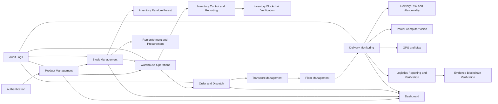

## Module URLs verified locally; publication held — 3 November 2026

Separate module and shipment/purchase/Customer detail URLs are implemented in the isolated checkout with login/role isolation, browser history and unsaved-work protection. Local build/lint, route and actual browser checks pass; see docs/MODULE_URL_NAVIGATION_LOCAL_2026-11-03.md. The user explicitly requested no Firebase release until after the supervisor session and separately authorized saving the code to the private GitHub repository. Current hosted app/MSI services are unchanged; parcel and phone testing remain deferred.

## Computer-use AI and location walkthrough — 3 November 2026

A user-requested hosted-browser walkthrough exercised a fully fictional Stock AI scenario, then a separate new demonstration product/shipment through warehouse picking, packing, handover, transport scheduling and dispatch. Delivery RF prediction and separate rules were saved; the fresh delivery remains In Transit for practice. Both AI histories were inspected and the stock history was reopened. Class scores are uncalibrated; the delivery result retained out-of-development-range warnings. This is workflow evidence, not independent accuracy validation.

The user explicitly approved one MSI browser-location point for the fictional shipment. One capture request saved a point; its submission time and reported accuracy were confirmed in a second tab using the same Admin session. The local receipt excludes coordinates, and its location screenshot excludes the map. This supersedes the earlier browser-GPS deferral only for this one-shot MSI check; physical Android, continuous/background GPS and offline trials remain deferred.

Detailed fictional record references, outcomes and screenshots stay in the ignored app-relative outputs/supervisor-ai-walkthrough-20261103-FnaYjr/ folder (result.private.json). Do not upload this evidence/test data to GitHub. The active demonstration shipment holds its assigned resources; complete its normal delivery workflow when finished practising. Proof upload and final Delivered status for this new case, independent review with a different account, parcel/camera tests, physical phone trials, full shutdown recovery and Git publication were not performed. No application code, deployment, roles, service bindings or existing record balances changed in this walkthrough. The current Fleet/Transport release and Desktop launcher binding remain unchanged.

## Fleet and Transport interfaces published — 3 November 2026

Fleet now uses Vehicles / Drivers / Fuel & Maintenance tabs and separate forms; Transport uses status tabs, focused plan details and a grouped editor with an optional collapsed map. Labelled semantic colours and dirty-close/recovery guards are verified. The user explicitly requested this live update; Firebase Hosting version 071e49fb6d97b1c3 and all 17 app assets verified. All 876 cloud documents, nine Auth accounts/eight approved app profiles, rules, numbering, 11 frozen artifacts, 19 immutable proofs, the current chain/tunnel and two wallet receipts were preserved. Three exact application services restarted with regenerated metadata (only the two existing UI source pins changed); Desktop all five Ready. Billing stays disabled.

Verification: four presentation tests, 22 browser groups with desktop/390px checks and 56 tab-contrast samples; 59 foundation, 159 input and 57 stock/location checks; original Firebase smoke/QA and four affected actual Fleet/Transport scenarios with exact cleanup; reviewed build, lint (0 errors/14 existing warnings), current/history secret checks and 17 release/Auth guards. Independent final review clear. Actual hosted forms/details checked read-only; no new records or assignments.

Application-relative current private pointer: outputs/spark-msi-demo-20261028/fleet-transport-ui-live-20261103/cloud-runtime-fleet-transport-ui-published-20261103.private.json. Use the existing Desktop Start IILAS Demo shortcut, not one-time release helpers. See app docs/FLEET_TRANSPORT_UI_LIVE_2026-11-03.md and docs/SUPERVISOR_MODULE_TEST_GUIDE_2026-11-03.md. UX-004 packed Fleet/Transport tasks is fixed live; UX-001 barcode guidance and UX-002 completed-notification dismissal remain deferred. Parcel/camera, physical phone/GPS/offline, full shutdown/chain recovery and Git publication remain deferred. Keep MSI awake/online.

## Shipment-date fix live; all role-testing accounts ready — 3 November 2026

New shipments require today/future expected delivery in Malaysia time, enforced by picker minimum, visible guidance, submission validation and the trusted new-record boundary. Existing overdue records, dispatch, historical decoding and exact midnight replay remain intact. Four source files deployed through a coordinated MSI restart and Hosting-only publication; rules, numbering policy, 11 frozen models/artifacts, current chain, both wallet receipts, tunnel and 19 earlier proof/store files preserved. Fresh backup covered 859 then-current cloud documents. Verification passed 50 focused tests, 159 input checks, six sequential emulator suites, build/lint (0 errors/14 existing warnings), secret/history scans, desktop/390px fixtures and four live checks. Today's fictional SHP-000003 remains a Draft; yesterday was rejected without writes or a consumed code. Desktop all five Ready, billing disabled.

The six user-approved Gmail aliases for Inventory, Warehouse, Logistics, Driver, Viewer and Customer completed normal verification, normal Admin role approval and real email/password login checks. Original Admin/Manager remain unchanged. The live User Management page shows all eight approved app-role accounts. Passwords are only in restricted local storage and a protected MSI Downloads/IILAS-PRIVATE-TEST-ACCOUNTS/IILAS-ROLE-TEST-ACCOUNTS.txt sheet; no secrets were displayed or uploaded. All aliases share one mailbox and do not establish independent human evaluation. Driver assignment and Customer shipment grants remain separate explicit tests.

Current private pointer: outputs/spark-msi-demo-20261028/shipment-date-live-20261103/cloud-runtime-date-published-20261103.private.json. Use the Desktop launcher, not one-time release helpers. Read docs/SHIPMENT_DATE_FIX_2026-11-03.md, docs/ROLE_TEST_ACCOUNTS_2026-11-03.md and docs/SUPERVISOR_MODULE_TEST_GUIDE_2026-11-03.md. UX-001 barcode guidance and UX-002 success-notification dismissal stay deferred; UX-003 past-date creation is fixed. Parcel/camera, physical phone/GPS/offline, new wallet signing, full shutdown/chain recovery and Git publication remain deferred.

## Automatic locked business codes live and supervisor guide verified — 3 November 2026

The coordinated existing-project update is published. New products, shipments and ordinary/linked purchases receive server-generated locked PRD/SHP/PO codes; existing codes and manufacturer barcodes are preserved. All 17 application assets and deployed Firestore rules were independently verified. Billing remains disabled. The Desktop launcher reports all five services Ready; scientific model artifacts, current chain generation, both wallet transactions and earlier proof bytes are unchanged.

Eight fictional authenticated live checks passed: generated codes and exact replay; duplicate/manual-code/oversell prevention; stock receipt/reserve/release; different-Manager PO approval and 4+6 receipts; warehouse/transport/dispatch; fictional PDF and Delivered status; inventory/logistics statistics; private numbering denial and original-record preservation. Run SUP-261103-6B5F51 retained PRD-000001 / PO-000001 / SHP-000001, with final stock 27. An attempted duplicate driver profile was correctly refused; the same shipment resumed using a free existing registered driver, with no role/profile changes. All 757 earlier cloud documents are unchanged and each scoped numbering counter advanced once.

Use [the step-by-step supervisor guide](docs/SUPERVISOR_TEST_GUIDE_2026-11-03.md) and [live acceptance](docs/AUTOMATIC_CODES_LIVE_ACCEPTANCE_2026-11-03.md). The guide includes expected balances, account separation, recovery controls and a blank result checklist. The supervisor's manual session is still to be performed. Parcel/camera, physical phone/GPS/offline, new wallet signing, full shutdown/chain recovery and Git publication remain deferred. Do not rerun one-time initialization/deployment helpers for startup.

## Reports graphs published; automatic business codes next — 2 November 2026

Reports & Statistics is live for both portfolios, retaining the five accepted operational interfaces. The reporting-only backend update and guarded serving metadata refresh preserve scientific model data, all11 frozen artifacts, current chain/tunnel/proof root and both wallet receipts. Exact17-asset publication, eight protected records,16 immutable proofs,39 Reports tests, four recovery-source tests,22 startup tests, original Firebase/procurement regressions,23-preset source comparisons and live read-only overview/source probes pass. Desktop reports all5Ready; billing remains disabled. See [live reporting guide](docs/REPORTS_STATISTICS_LIVE_2026-11-02.md).

Next user request: automatic product SKU/item codes and shipment/purchase references across relevant modules. The [audit](docs/AUTOMATIC_BUSINESS_CODES_AUDIT_2026-11-02.md) confirms database IDs are already automatic and identifies manual business-code fields. The user selected always generated and locked codes and approved the [written design](docs/superpowers/specs/2026-11-02-automatic-business-codes-design.md). It preserves existing codes, factual barcode entry and exactly-once recovery; its fresh builder check found nothing important left. The [seven-task Native plan](docs/superpowers/plans/2026-11-02-automatic-business-codes.md) is prepared and self-reviewed, awaiting human plan review. No code-generation behaviour or existing record changed. Parcel/camera and physical phone tests remain deferred.

## Spark + MSI FYP software demo ready — final 29 October 2026 status

The approved demo is live at https://fyp-inventory-and-logistics.web.app. Final read-only verification passed seven software checks, three recovery checks, both human-confirmed blockchain registrations and all six observed gates. Both retained integrity checks are Verified; fresh signed-in 1440px/390px layouts have no document-wide horizontal overflow. Original-laptop evidence remains earlier human attestation with unchanged client/Hosting/API continuity.

Latest private pointer: `outputs/spark-msi-demo-20261028/cloud-runtime-after-service-rehearsal.private.json`. The follow-up API/model restart rehearsal passed all three recovery checks, preserving all 344 cloud records, seven proof files and both chain receipts; read-only browser walkthrough passed afterwards. Hardhat/ngrok and Windows were not restarted. Coordinated backup verifies 344 records, three Auth accounts and 17 Hosting resources. All 128 original typed records/timestamps remain unchanged. The intentional Manager password reset is preserved; Manager role restored. Billing stays disabled. All 199 registered fictional demo records remain for presentation; no deletion approval or destructive-cleanup certificate was assumed.

An initial expired, unbroadcast wallet claim needed an exact audited operator cancellation after no-transaction proof. Two later user-confirmed registrations and saved-outcome recovery passed; do not claim the expired claim repaired itself. No app/model change or scientific reevaluation occurred during final handover. Parcel/camera, physical Android/GPS/offline, restore/power-loss rehearsal and Git publication stay deferred. Keep MSI awake/online. See [current guide](docs/SPARK_MSI_CLOUD_STATUS_2026-10-29.md). This section supersedes older pending/import/backup statements below.

## Approved chain connection and repeated cloud software checks — 29 October 2026

The user approved e2f7fed76b22. The API now uses the verified current private registry/process; same sources, models, public origins and proof bytes preserved. Seven software checks pass in CLOUD-00e13bd5, using the earlier available demo Driver profile read-only after duplicate creation was correctly rejected. Its temporary assignment was released; all original/earlier fixture rows remain unchanged. Original failure and successful continuation receipts are separate. The second account returned to Manager.

Latest active pointer: outputs/spark-msi-demo-20261028/cloud-runtime-after-wallet-recovery.private.json. Three fresh actual recovery checks also pass, with current API/model owner receipts under acceptance-resumed-02/recovery-runtime; cloud rows/proof bytes unchanged. Current state328documents/90new registered fixtures; two-source manual trial declaration frozen before registration. Actual signer preflight found that the app requires registry deployment account0xf39F…2266; extra registrar permission for the newly created wallet does not replace that selection. A published Hardhat test-account key was prepared privately outside Git/OneDrive with user/SYSTEM ACL; the user can open its restricted Downloads copy and is importing it manually. Two business signatures remain pending. No source change, real funds or business wallet signature occurred. Browser security policy blocks extension pages; do not bypass it. Fresh post-wallet backup and exact cleanup remain pending; billing/parcel/phone/Git publication stay excluded.

## Original laptop and local wallet setup — 29 October 2026

The user confirmed the deployed app works on the original laptop; the record is explicitly human-attested. MetaMask on MSI now has IILAS Local Demo selected and visibly shows100local test ETH. A fresh private chain/unchanged registry and registrar permission are verified; it is not restored chain history. The current API still has its earlier binding. The [exact connection review](docs/SPARK_MSI_WALLET_ACTIVATION_REVIEW_2026-10-29.md), subject e2f7fed76b22, prepares the API restart and a fresh registered software run before the two manual wallet checks. Replacement executable approvals are absent; no new cloud writes or API cutover occurred.

Current active private pointer: outputs/spark-msi-demo-20261028/cloud-runtime-after-laptop.private.json. Five of six observed participant/recovery/browser gates are evidenced; wallet acceptance and separately approved cleanup remain pending. Billing, Git publication, parcel and physical Android/GPS trials remain excluded. This section supersedes older laptop/chain-setup status below.

## Authenticated MSI browser verified — 29 October 2026

Normal selected-Admin sign-in was observed on the live Firebase site. Seven read-only visual/native-accessibility cases pass at1440px/390px: dashboard/navigation, stock balances and AI form, saved delivery/risk/proof link, completed purchasing and the bounded demo-product report. Fresh read-only cloud capture confirms all232documents/timestamps and IAM/services unchanged, billingfalse. Viewport override was removed and dashboard/side-by-side workspace restored. DOM console/scroll-width measurements were unavailable; no such automated claims are made.

Latest private runtime pointer: outputs/spark-msi-demo-20261028/cloud-runtime-after-browser.private.json; oldpointer retained unchanged. Browser receipt and the four-of-six observed gates are in the corrected packet acceptance-run. Next: actual original-laptop trial, current-chain rebinding/manual wallet verification, then later exact fixture cleanup. Parcel/physicalAndroid/Gitpublication remain deferred. This section supersedes the older browser-pending statements below.

## Spark cloud demo live — 29 October 2026

The corrected approved release is live at https://fyp-inventory-and-logistics.web.app with billing disabled. Existing verified Admin/Manager setup, seven actual cloud workflow checks and three controlled recovery checks pass. All128original typed cloud documents/timestamps and three Auth accounts/credential flags are unchanged. Frozen stock8001/delivery8002 and the authenticated MSI API8011/ngrok are running; post-trial232documents/3accounts/17hosted resources and four MSI proof-store files are privately backed up and verified.

Current [status/startup guide](docs/SPARK_MSI_CLOUD_STATUS_2026-10-29.md); authoritative private pointer outputs/spark-msi-demo-20261028/cloud-runtime-current.private.json. The old local runtime-final pointer and old retired API PID are historical. The earlier emulators/web/chain were absent after the break; only the model services were restarted. Blockchain is pending a current local chain binding and manual wallet checks; no old chain history is claimed restored. Normal signed-in desktop/narrow browser, original-laptop trial and later exact fixture cleanup remain pending. Parcel/physicalAndroid remain deferred. No billing/API/IAM expansion, data restore/merge, Git stage/commit/push or scientific reevaluation occurred. This section supersedes activation-pending and stopped-runtime statements below.

## Spark activation recovery — 29 October 2026

The approved first cloud attempt created107READY indexes and stopped before rules/Hosting when the provider rejected a virtual default override. Original128cloud docs/3accounts and disabled billing are preserved. The correction is verified (95focused checks plus original regressions); the exact replacement [activation review](docs/SPARK_MSI_INDEX_RECOVERY_REVIEW_2026-10-29.md) awaits confirmation of its changed fingerprints. No active public tunnel/API; account bootstrap, cloud workflows, browser/remote/manual wallet acceptance and later exact fixture cleanup remain pending. Parcel and physical Android trials stay deferred.

## Spark + MSI local demo verified — 28 October 2026

Native Tasks1–9 are locally verified after review fixes:53focused/82legacy cases,8original Firebase suites/53workflow cases, MSI stock11/purchasing-browser5/delivery10 and18API/browser/chain cases pass; native59tests each flavour/builds/privacy pass. Original data and frozen science are preserved. The Hosting package is fixtureOnly and unpublished. User prefers Firebase Hosting first; real credential/HTTPS/production activation wiring and remote acceptance remain gatedTask10, billing disabled. Parcel/phone trials stay deferred; no cleanup route is wired. See [local acceptance](docs/SPARK_MSI_LOCAL_ACCEPTANCE_2026-10-28.md) and [activation review](docs/SPARK_MSI_ACTIVATION_REVIEW_2026-10-28.md).

# IILAS Project Roadmap

## Spark + MSI backend selected — 28 October 2026

The user chose Firebase Spark for existing Hosting/Auth/Firestore and MSI for trusted commands, private proof files, AI and blockchain, with billing disabled. This supersedes the Cloud Functions/Cloud Storage deployment plan. The user approved the [written design](docs/superpowers/specs/2026-10-28-firebase-spark-msi-backend-design.md). Its [ten-task Native plan](docs/superpowers/plans/2026-10-28-firebase-spark-msi-backend.md) is saved/self-reviewed and awaits human plan review: Tasks1–9 are local implementation/verification; Task10 retains separate exact credential/IAM/HTTPS/cloud-write gates. Billing remains prohibited throughout. The prior offline backup/adoption guard passes7tests and validates128cloud documents; runtime/SDK/file/native adapters have not yet changed. Current cloud records, local emulator data, models and chain remain separate/preserved; no billing, IAM, public endpoint or deployment action. Parcel testing stays paused and actual phone tests pending.

## Existing Firebase destination selected — 28 October 2026

The user now chooses reuse of `fyp-inventory-and-logistics`, superseding the earlier separate-project choice, and explicitly prohibits enabling billing. Read-only cloud audit/backup and the revised deployment plan are prepared:128documents/3Auth accounts, private hash parameters/rules/index metadata/current Hosting assets verified; no Storage buckets. [Audit](docs/EXISTING_FIREBASE_CLOUD_AUDIT_2026-10-28.md) and [plan](docs/superpowers/plans/2026-10-28-existing-firebase-msi-hybrid.md). Cloud data has no shared access configuration, the selected Admin email needs normal verification, and the current CLI account is Editor. Current product code/guards remain unchanged pending approved local adoption work; no billing/API/IAM/data/deployment/tunnel changes occurred. Existing owner groups remain separate; the MSI test snapshot is not imported.

## Hybrid cloud/MSI preparation — 27 October 2026

Tasks1–8 implement and locally verify explicit profiles, signed gateway/model/chain adapters, protected web access, separate Android flavours and dry-run deployment staging. Final evidence on 28 October:75 focused software tests,53 workflow checks, both native flavours54 tests each, original eight Firebase suites and exact fixture cleanup. The [preparation audit](docs/HYBRID_DEMO_LOCAL_PREPARATION_2026-10-27.md) records preservation and the single source review. Tasks9–10 remain awaiting exact new-project/provider/account/region/billing/deployment authorisation and actual cloud verification. Parcel testing remains paused, actual phone/GPS/offline trials remain pending and model studies are unchanged.

## Android Driver extension — 26 October 2026

The approved React/Capacitor Android extension is implemented with app-private Room/SQLite assignment cache and immutable outbox, background location foreground service, explicit Start/Stop,30minute offline lease and automatic original-account drain. Named local Firebase commands preserve assignment/version authority, atomic receipts and proof finalisation. Normal web staff/Customer entry remains separate; parcel testing remains paused.53 native software tests,36 focused Node tests, real mobile Firebase5 scenarios/90 private-rule denials and1440/390 UI fixtures passed; all eight original suites,27 actual web/emulator workflow cases and frozen stock11/purchasing-browser5/delivery10 gates also passed; final live1665/116/2 state is exact. Automated acceptance passed21gates. The user will connect the phone later: APK installation, native SDK/device round trips, permissions, real background GPS and actual USB loss/reconnect remain **pending**, not passed. See [Android acceptance](docs/ANDROID_ACCEPTANCE_2026-10-26.md).


## Local FYP completion checkpoint — 25 October 2026

- [x] Shared exact-operation recovery and closed local capability contracts.
- [x] Both local blockchain registration/check workflows and independent retained exception review.
- [x] Fleet editing, assignment availability, atomic pre-dispatch reassignment and explicit map planning estimates.
- [x] Isolated approved Customer portal, explicit shipment grants and protected current proof download.
- [x] Bounded filters/reports/CSV and access to older review/registration candidates.
- [x] Source-bound preserved local cutover,27 actual scenarios,eight original regression suites and11 stock/five purchasing-browser/ten delivery checks.
- [x] Report matrix, academic supporting draft, user/recovery guide, editable diagrams and slides.
- [ ] Participant acceptance: real MetaMask, physical browser GPS and student/supervisor rehearsal.
- [ ] Parcel photo/live testing remains paused at the user's instruction.

These are local FYP demonstration results. No production deployment, Git publication or independent real-world AI accuracy claim is included. See [completion audit](docs/FYP_COMPLETION_AUDIT_2026-10-25.md). Additional features remain deferred.

## Delivery-risk FYP demonstration verified — 25 October 2026

The approved eight-task Native implementation is verified locally. Delivery Monitoring now uses an actual frozen three-class RF, trusted as-of shipment/event/proof facts, separate retained abnormality assessments, independent manager review revisions and exact saved-operation recovery. Driver recovery remains available after reassignment. History retains original facts/model/policy identity, all three uncalibrated scores and range/data-review/timeout warnings. No automatic stock, shipment, order or notification action follows.

The grouped synthetic study used 1,200 snapshots/300 families and 11 development fits, then one frozen 180-row/45-family TEST evaluation. RF accuracy 98.33%, macro-F1 .9840, High precision 97.37%, recall 100%; family-bootstrap accuracy interval 96.11–100%. DT 99.44%, LR 92.78%, Dummy 43.89%. These measure agreement with the AI-authored synthetic triage policy, not genuine delivery forecasting. RF remains the report main model despite the stronger DT test result. No consumed TEST replay/refit occurred.

Ten actual model/Firebase/browser checks pass with exact fixture cleanup, including lost successful start/review replies, two independent review revisions, invalid expected-window Unavailable and closed rules-only handling. The predeclared Low/Medium/High workflow cases predicted Low/High/High; the first-failure Medium disagreement is retained. Early dispatch minutes fall outside some TRAIN ranges; warnings remain visible. Three callable probes took 3.034–3.059 seconds, with 27.17–28.63 milliseconds inside RF prediction. This tiny software trial is not an accuracy estimate or service guarantee.

All 14 preservation-harness entries, two actual stock purchasing/browser suites and five stock follow-on suites pass. Thirty focused delivery JS and 37 Python software/service checks pass. Build passes; lint has zero errors/six existing warnings. One fresh source review found three Important UI defects, fixed with rendered regressions. Parent visual checks confirmed 1440px/390px layouts without overflow. Two minor formatting/spacing items remain deferred. Datasets/models/private configuration/exports/evidence remain ignored; no publication, production, camera collection or unrelated feature work occurred.

[Local guide](docs/DELIVERY_RISK_DEMO_LOCAL_GUIDE_2026-10-24.md). [Delivery contract](docs/DELIVERY_RISK_DEMO_CONTRACT_2026-10-24.md). Independent real-delivery forecasting, richer weather/traffic/route inputs and a prospectively registered improvement cohort remain future work, not prerequisites for this disclosed FYP prototype.


## Delivery-risk FYP demo design ready — 24 October 2026

The user selected **simulated three-class RF plus separate rules**, explicitly extending simulation to delivery. This supersedes historical delivery-AI deferral for the approved next demo project; camera trials and additional features stay deferred. The two-report/read-only local audit found20shipments,10Dispatched,6terminal delivery records,0current transit records,0risk labels and5nonpositive expected windows. Existing records remain untouched. The recommendation is a real fitted RF for Low/Medium/High **as-of simulated policy judgements**, DT/LR comparisons and a separate retained abnormality/review workflow inside Delivery Monitoring, preserving Prepared-Shipment Handover.

The written design proposes300families×4snapshots,grouped70/15/15 separation,11bounded development fits,explicit synthetic-label provenance,independent manager review and actual model/Firebase/browser verification. These are builder proposals, not measured results or user-supplied thresholds. A fresh builder check returned **nothing important left**. The user approved the written design. The eight-task implementation plan is prepared and self-reviewed; plan confirmation is pending, with the existing **Native** preference preserved. No generation/fitting/application/model/service changes, commits or production actions occurred. Do not repeat the selected simulation route or ask for real business deployment qualification as a prerequisite to the FYP demonstration.

[Delivery demo design](docs/superpowers/specs/2026-10-24-delivery-risk-demo-design.md). [Eight-task implementation plan](docs/superpowers/plans/2026-10-24-delivery-risk-demo.md).

## Stock worker response-time improvement — 24 October 2026

The approved serving-only optimization passes its registered five-before/five-after comparison: median direct HTTP time7.060s →5.340s, a24.37% reduction. All ten requests have confirmed native cleanup; model/scientific identities and labels match, with maximum probability delta1.388e-17 within absolute1e-12. This is one fictional scenario on MSI, not accuracy or an SLA. Fresh stat-based accounting retains the resource/Job/cleanup controls and existing per-request worker. Frozen training/runtime/model/metrics and retained evidence remain unchanged. Independent review's benchmark stop-on-drift finding was fixed RED→GREEN;205 JavaScript checks pass.79 Python cases:78 pass/one optional symlink skip; mandatory native junction passes. All55 actual workflow/model/browser checks and original smoke/QA/stock-assessment preservation suites pass (six harness entries). Build passes; lint0errors/six existing warnings. Final source/hash/privacy/state certification is recorded in the ignored `outputs/inventory-worker-output-scan-20261024/final-verification.json` receipt.

Current safe profile receipt: `outputs/inventory-worker-output-scan-20261024/profile-receipt-01.json` inside `iilas-fyp`. Schema5/protocol2 retained;40 stock source pins, manifest SHA256 `6bd64eb0a11a16baa2cec386fac6ef876aa672daa2405e3d1c25bdb4dba2c70e`. Parcel binding/authentication and its running service are unchanged. Fresh current-state checkpoint: `outputs/inventory-worker-output-scan-20261024/emulator-checkpoint-01`,11 verified files;1665documents/116accounts/twoobjects preserved through import, allowing only normal Auth timestamp variance. Export and verify then-current state before any future stop; never substitute an older snapshot over newer work. Backend session77487, stock39056; parcel10548 and Vite20375 retained. Listener observations:backend18296/Firestore18604/stock20080/parcel13008/Vite10244. Reidentify listeners before stopping processes. Use literal http://127.0.0.1:5173 and one emulator stack.

The user keeps AI-assisted prototype labels only. Frozen simulated accuracy81.53%, Critical precision79.00% and recall87.78% do not establish independent warehouse accuracy. Genuine factual history and independent intended-use qualification remain open; camera/otherAI/extras are deferred. No stage/commit/push/merge/deploy/production action. Preserve the checkout and own ignored Native ledger/snapshots because no commits were made. The original before baseline and harness version are retained; the reviewed validation-only harness revision is separately recorded. One Minor generic-failure-diagnostic deferral remains. This latest section supersedes historical pending-approval and runtime pointers below.

See the [measured optimization and restart guide](docs/INVENTORY_WORKER_OUTPUT_SCAN_2026-10-24.md).

## Stock prototype labels and response-time audit — 24 October 2026

The user selected **AI-assisted prototype labels only** for the next quality step; independent human labelling and genuine-history qualification remain deferred. Do not repeat the reviewer-availability question. The completed demo purchasing workflow remains verified and unchanged. A fresh read-only audit again finds44active products,0verified history windows and0independently labelled snapshots. Three serial direct RF14 service probes on one fictional scenario pass with native cleanup: RF probability calculation16.69–27.95ms, worker2.248–2.423s, service6.894–7.505s, HTTP6.904–7.513s. These are software timing observations, not accuracy or Firebase/browser latency. One metadata-only profile took0.638s; no model was loaded by that profile. No training, scientific TEST replay, service restart, Firebase write or source-bound runtime change occurred.

The user selected **optimize the existing worker**. A supervised parent profile identifies output-folder accounting as the main cost:15 scans accumulated6.888s in an8.460s profiled request, with native cleanup confirmed. Keep the frozen scientific runtime unchanged; the proposed design uses a serving-only scanner/supervisor with guard-parity tests. A fresh builder check found nothing important left. The user approved the written design on24October. Its four-task Native plan is saved and self-reviewed; the user approved it on24October and Native implementation is underway. Do not repeat the selected approach, design approval, prototype-label origin or Native method questions. Preserve resource/hash/cleanup/recovery controls and the already selected Native execution preference. Keep camera, other AI and extras deferred. See the [completion and next-work audit](docs/INVENTORY_STOCK_AI_COMPLETION_AUDIT_2026-10-24.md).

## Demo requirement-to-purchase workflow — 24 October 2026

The six-task Native implementation is verified locally: actual frozen-RF14/Firebase purchasing11 checks and real-browser5 checks pass, with exact fixture cleanup. All ten preservation suites (13 harness entries) and prior reorder9/demo-product10/browser7/context7/legacy6 checks pass.194 focused JavaScript,59 affected Python and65 fixture-browser checks pass. Build passes; lint0 errors and6 existing image warnings.

Accepted demo requirements can explicitly create one source-linked, single-product purchase order. Staff enter supplier, quantity, cost and date; a different Admin/Manager approves the PO. Issue creates expected incoming; explicit partial/full receipts atomically update incoming, purchase history and location-aware demonstration stock. Permanent links prevent duplicate orders, and exact saved-operation recovery covers lost replies. Original experimental model provenance stays unchanged. Historical/manual orders are not backfilled. Creation-disabled admitted approval/recovery works without model configuration. A reproduced Firestore absent-link read defect was fixed; known shared requirement reads succeed while unknown/foreign reads, unscoped lists and direct writes remain denied.

This implements the demo FR-24/25/26/27 chain. It does not qualify genuine inventory history or independent intended-use accuracy, and sends no supplier messages. The frozen RF14 simulated study remains81.53% accuracy, Critical precision79.00%, recall87.78%; no retraining or consumed-TEST replay. Next stock work is independent intended-use evaluation and trustworthy factual-history qualification. Camera, other AI and additional features remain deferred. The single fresh final review found one Important outcome-correlation defect, fixed RED→GREEN; no Minor was raised in this review. The earlier retained-event correlation deferral is addressed by exact Accept-event proof.

Current schema5 safe receipt: `outputs/inventory-demo-procurement-20261024/profile-receipt-03.json`; private profile: `outputs/inventory-ai-20261023/profile-46cc30fe-56ef-4439-982c-6ecde5682652/private.json` inside the app. Never display its contents. Stock source binding:39 pins, SHA256 `87c9755f3fd3fa02f18620e43925b0d7df3f521ed441432891516ffa10b558f3`. Verified checkpoint: `outputs/inventory-demo-procurement-20261024/emulator-checkpoint-02`,11 files. Recovery and final cleanup preserve1665 documents/116 accounts/two stored objects, allowing only normal Auth import timestamp variance. Export then-current state before any future backend restart; never replace newer work with an older checkpoint. Current sessions: backend1697, stock47353, parcel10548, Vite20375. Listener observations: backend10168/Firestore2064/stock1600/parcel13008/Vite10244; reidentify before any stop. Use literal http://127.0.0.1:5173 and one loopback stack. RF14 admission requires3GiB available RAM; no limits were lowered and no unrelated apps closed. All code/data/model/configuration/export/recovery changes remain local/unpushed; no production changes. Preserve the checkout, ignored Native ledger and evidence.

See the [purchasing guide](docs/INVENTORY_DEMO_PROCUREMENT_LOCAL_GUIDE_2026-10-24.md). This latest section supersedes historical pending-plan/runtime pointers.

## Next stock integration selected: demo requirement to purchase and incoming stock — 24 October 2026

Previous goal turn was verified progress: all six demo alert/reorder Native tasks completed. A fresh original-report/code/read-only-data audit confirms FR-27 still lacks a trusted requirement-to-PO link and an expected record after issue. User selected **existing purchase orders with clear demo lineage**, rather than a separate demo purchasing lifecycle. Preserve this choice and their Native execution preference.

The user approved the [written design](docs/superpowers/specs/2026-10-24-inventory-demo-procurement-design.md) on24October after its fresh builder check returned **nothing important left**. The [six-task implementation plan](docs/superpowers/plans/2026-10-24-inventory-demo-procurement.md) is prepared and self-reviewed; the user approved the plan and Native implementation is underway. It covers explicit single-product linked POs, separate purchase approval, exact recovery, immutable accepted-source proof, and issue/partial/full-receipt expected records. Permanent one-order links and no legacy backfill are part of the approved design. No application code, business data, model, profile or current runtime changed during planning. Latest read-only audit:47products/192movements/26POs/91POevents, with no source-linked order or expected record. Keep the full stock objective incomplete for independent intended-use/genuine-history qualification; camera/otherAI/extras stay deferred. The prior design-approval blocker is resolved; do not repeat that question or the route/Native choice.

## Demo stock alert/reorder workflow verified locally — 24 October 2026

The approved six-task Native implementation is verified: risk-only atomic demo alerts/requirements, independent Admin/Manager decisions with stale Accept protection, separate bounded Procurement queue and exact review recovery. Both Important final-review findings were fixed RED→GREEN; one Minor retained-event correlation issue is deferred.157 JS/59 affected Python/49 fixture-browser checks,14 emulator suites and actual reorder9/browser3 plus demo-product10/browser7/context7/legacy6 pass with exact cleanup. Build passes; lint0errors/6existingwarnings; secret scans and33protected/fiveprivate hashes pass. Full stock goal stays active: FR-27 requirement→PO→expected incoming and independent intended-use/genuine-history qualification remain incomplete. Camera/otherAI/extras remain deferred.

Current profile:C:/Users/Home/OneDrive/Documents/FYP CWK project full/iilas-fyp/outputs/inventory-ai-20261023/profile-1c1ef848-a692-4f28-b0cd-1a54c805c946/private.json; stockmanifest05 SHA256:41a6215c9e0920ac053af2d2aaa1289d34569157d722205da99d7b9bc62aa950. Private values must never be displayed/uploaded. Current checkpoint:outputs/inventory-demo-reorder-20261023/emulator-checkpoint-03 within the app. All11 export files verified;1665documents/116accounts/twoobjects preserved, allowing only normal Auth import tokensValidAfterTime changes. Sessions backend25275/stock56695/parcel5725/Vite1200. Listener observations backend22172/Firestore5252/stock13508/parcel17664/Vite19088; reidentify before any stop. Use literal http://127.0.0.1:5173 and only one emulator stack. No stage/commit/push/merge/deployment/production action. Keep branch codex/native-tabular-runners and ignored ledger/evidence. See [current guide](docs/INVENTORY_DEMO_REORDER_LOCAL_GUIDE_2026-10-23.md). This section supersedes historical pending-plan and runtime pointers below; do not repeat approved choices.

## Demo alert/reorder Native implementation underway — 24 October 2026

The user approved the written six-task plan. Tasks1–5 pass their contract/command/client/UI/profile gates, including59 affected Python checks. Task6 now prepares the preserved local cutover and actual Firebase/model/browser verification. Continue the current Native ledger; do not repeat route/design/plan approval. This supersedes historical planning-pending statements below. No stock, purchase-order or production changes are authorised. FR-27 and independent intended-use qualification remain later core work.

## Next stock step selected and designed: demo alerts and reorder review — 24 October 2026

The previous goal turn completed the six-task demo-product RF14 integration and its terminal verification. A fresh report-to-code audit now identifies the next core gaps: FR-12 automatic risk alerts, FR-13 persistent reorder requirements and FR-21 manager review. Current Procurement only derives a threshold list. The user selected **Demo risk alerts and reorder review** and approved docs/superpowers/specs/2026-10-23-inventory-demo-reorder-design.md after its fresh read-only builder check returned “nothing important left”. Do not ask the route/design/Native method again.

The six-task plan docs/superpowers/plans/2026-10-23-inventory-demo-reorder.md is written and self-reviewed; plan review is pending before implementation. It specifies risk-only atomic demo alert/requirement creation, independent Admin/Manager decisions and recovery, a bounded separate Procurement queue, explicit schema4 capability and preserved local cutover/actual tests. Normal/Unavailable/manual/old results create no items; no stock/PO/operational-alert write or model-quality promotion. No application source, profile, model or data was changed during this audit/planning continuation. Current profile/services from the completed integration remain valid.

Read-only current-state evidence:47products,192movements,zero retained experiments and zero proposed demo alert/reorder/event/request records in the selected scope; stock health artifact_ready, reorder capability disabled. Ignored evidence outputs/inventory-stock-completion-20261023 contains requirements-audit.json/current-state.json. Original report hashes were reverified; paragraph544 permits simulated prototype scenarios with limitations. This makes progress without claiming genuine inventory quality. FR-27 requirement-to-PO/expected-incoming linkage and independent intended-use qualification remain later core work. Keep the full stock goal active; other AI/camera/extras remain deferred.


## Selected demo-product stock experiments — 23 October 2026

The approved local workflow connects the same frozen RF14 to a selected demonstration product: three trusted balance facts and eight explicitly fictional context facts. Product changes during inference retain Unavailable against the original snapshot; old/manual/demo saved requests recover through their own protocols. No stock/procurement/operational-alert write or genuine-readiness promotion follows. Actual 10 emulator and 7 browser checks pass with exact cleanup, along with 117 focused JS and 59 affected Python checks and 29 fixture-browser scenarios. All 13 sequential Firebase suites pass with exact cleanup; the fresh review found no Critical/Important findings and one deferred refresh-UX minor. Synthetic accuracy 81.53%, Critical precision 79%, recall 87.78% are unchanged; real-history qualification and independent evaluation remain incomplete. See [local guide](docs/INVENTORY_DEMO_PRODUCT_AI_LOCAL_GUIDE_2026-10-23.md).


## Readiness audit and next selected demo-product step — 23 October 2026

The user confirmed current local inventory is entirely demonstration/test data. The [read-only audit](docs/INVENTORY_DATA_READINESS_AUDIT_2026-10-23.md) verified44 active products/192 movements,zero qualified 30-day windows andzero independent stock labels, with source hashes stable across reads and no database writes. Current recorded balances are valid for demo software testing; receipt age is known for25 products. This does not qualify real-world accuracy or allow unknown history/context to become zero.

The user selected **connect selected demo products next**, using trusted recorded balances and eight explicitly fictional history/demand/supply facts. The [written design](docs/superpowers/specs/2026-10-23-inventory-demo-product-design.md) covers product-version fencing, retained experimental source lineage and all existing recovery paths. Its fresh builder check found no important unanswered questions; the user approved the design and its six-task Native implementation plan is written/self-reviewed; the user approved the plan and Native implementation is underway (Task1:30contractchecks pass). Native execution remains selected. The existing manual RF14 experiment and services are unchanged. This is a core product-to-model connection; real-product admission, independent intended-use evaluation and accepted alert/procurement integration remain incomplete. No new training, scientific TEST replay, camera/other AI work or production/publication is authorised by this audit.

## Context-aware stock experiment — 23 October 2026

The approved local integration now serves the frozen fourteen-input Random Forest through the existing experimental stock screen. Eleven explicit fictional facts include additional firm commitments and incoming supply. New version2 results bind the exact model, features and synthetic study; legacy six-input outcomes retain their original facts/metrics. Old saved requests resolve without fresh v1 inference. Real product history/readiness remains unqualified; no stock/purchasing changes or independent warehouse-accuracy claim follows.

Actual Firebase/RF14 and browser lost-reply/reload recovery passed with exact temporary-fixture cleanup. The controlled restart preserved 1,665 documents, 116 accounts and two stored objects; all required sequential regressions passed and the fresh reviewer found no blocking issues. Full isolated research collection: 60 modules, 1036 top-level test executions, 14 existing optional skips, zero failed modules. Synthetic accuracy81.53%, Critical precision79.00%, recall87.78% and accuracy interval78.54–84.86% come from the already consumed720-row/60-family study, not new test replay. See [current guide](docs/INVENTORY_CONTEXT_AI_LOCAL_GUIDE_2026-10-23.md). Qualified genuine history and independently labelled intended-use evaluation remain unfinished; the full stock goal stays active.


## Context model app integration design — 23 October 2026

The [new integration design](docs/superpowers/specs/2026-10-23-inventory-context-integration-design.md) follows the user's existing experimental-mode choice: extend the stock form with factual commitment/supply inputs, use frozen RF14 for new fictional scenarios, and preserve six-input history and request recovery. A fresh builder check found no important unanswered questions. The user approved this design on 23 October 2026. Its [six-task implementation plan](docs/superpowers/plans/2026-10-23-inventory-context-integration.md) is saved and self-reviewed; the user approved it on 23 October 2026 and Native execution is underway. Task1 passes22 JavaScript and6 Python checks; Task2 metadata/model adapter checks are in progress. The completed experiment is not repeated. No application/service/model switch has occurred. The full stock goal remains active; real-history qualification and independent evaluation remain unfinished.

## Revised stock experiment completed — 23 October 2026

The [completed experiment](research/INVENTORY_CONTEXT_EXPERIMENT_2026-10-23.md) passes its data, 52-fit development and independent saved-evaluation audits. On 720 scenarios from 60 held-out simulated families, RF14 achieves 81.53% accuracy/0.8080 macro-F1/79.00% Critical precision/87.78% Critical recall, versus RF6 45.83% accuracy/0.4066 macro-F1/zero Critical recall on the same cohort. Critical-as-Normal errors fall from 180 to 9; the paired macro-F1 interval is +0.3630 to +0.4405. These are synthetic-policy results; independent accuracy and operational approval remain false. All three phase claims are consumed and no test-driven retraining is allowed.

Next: separately review a 14-input experimental adapter/serving contract if integrating this candidate; first qualify actual cutoff-known commitments, supply, history and independent labels before real-product use. Preserve current six-input app/model/profile, Firebase state and original research. Build/lint/security checks, full58-module997-case regressions before the final admission correction, and42affected checks afterwards pass; one Minor timing finding remains documented. No production/publication/service restart occurred. Camera/delivery/extras stay deferred. Older pending-plan sections below are historical.

## Revised stock simulation selected — 23 October 2026

The user selected revised simulation with factual commitment/replenishment inputs. The [written research design](docs/superpowers/specs/2026-10-23-inventory-context-experiment-design.md) proposes 300 new ledger families with twelve grouped context views each, a fourteen-column RF compared with the six-input RF on identical new partitions, and DT/control comparisons. It explicitly prevents supply status from uniquely identifying the teaching label, preserves old consumed tests and keeps synthetic policy agreement separate from warehouse accuracy. A fresh builder check found nothing important left unanswered. The user approved the written design on 23 October 2026. The [six-task implementation plan](docs/superpowers/plans/2026-10-23-inventory-context-experiment.md) is written and self-reviewed, and its review is the next gate; no v2 cohort, training or app-model replacement has begun. Native execution remains selected; camera/delivery/extras remain deferred.

The latest stock UI follow-up also passed the existing seven-check rule-based stock browser suite. All UI fixes are complete under the prior approved integration plan; the current local model retains its original synthetic 75% accuracy and 45% Critical recall.

## Stock experiment UI reliability — 23 October 2026

The [local guide](docs/INVENTORY_AI_LOCAL_GUIDE_2026-10-23.md) records the two deferred UI fixes from the approved integration plan: arbitrary valid fractional receipt age and a35second command-observation deadline with retained exact recovery and late-response fencing.45focused checks,12browser fixture checks,7actual app/Firebase/RF checks, build/lint and sequential original smoke/QA plus stock-assessment regressions pass. Source-bound stock manifest05/profile and current-state checkpoint04 replace the previous startup bindings while preserving original artifacts,1665documents/116accounts/2objects and unchanged parcel service. Model weights, inputs/classes, science results and operating approval are unchanged. No training or publication occurred; the next experiment now follows the selected revised-simulation approach described above.

## Critical-stock development evidence — 23 October 2026

The [development investigation](research/INVENTORY_CRITICAL_DEVELOPMENT_AUDIT_2026-10-23.md) verified original saved predictions and240 development dossiers without fitting, model loading or held-out observation access. RF Critical recall spans66.25–67.50% across the original four settings; the selected RF calls21 of23 above-reorder Critical cases Normal. The original simulation also maps confirmed/planned/disrupted supply one-to-one to Normal/Reorder/Critical development labels. Supply status was not a model input, but adding it directly to that cohort would introduce an easy synthetic shortcut.

The recommended next research approach is varied coherent demand/supply contexts plus cutoff-known factual inputs, compared prospectively with the six-field baseline. The alternative is a bounded six-field parameter experiment with the missing-context limitation retained. The user selected the revised-simulation approach; the written design above is approved and its implementation plan awaits review. No new cohort or fitting is authorised by this evidence report. Existing held-out RF75% accuracy/45% Critical recall and the integrated artifact remain unchanged. Keep Native execution, private data boundaries and other-AI/camera deferral.

## Local stock-history audit — 23 October 2026

The [read-only readiness audit](research/INVENTORY_REAL_HISTORY_READINESS_2026-10-23.md) inspected current fixed-scope MSI emulator records: 44 active products, 192 movements, 25 eligible recorded receipts, no verified 30-day histories and no saved stock snapshots/review labels. All 290 queried documents, the system config/Admin profile and ten relevant sources remained unchanged. Real-world provenance is unverified; these records supply no qualified intended-use evaluation cohort. Balance-based checks remain available, while real-product AI remains Unavailable with unknown history preserved.

Next core work is a prospective Critical-risk improvement experiment for the approved simulated prototype, plus a documented provenance/coverage/independent-label process before actual-inventory admission. Do not switch readiness flags, fabricate real history, retune against consumed TEST or promote the DT using its observed test score. The experimental app remains available; no model/code/runtime or production change was made by this audit. Camera, delivery AI and extras remain deferred.

## Experimental stock app integration — 23 October 2026

The approved [local stock AI experiment](docs/INVENTORY_AI_LOCAL_GUIDE_2026-10-23.md) now connects manually entered fictional scenarios through Firebase to the frozen Random Forest. The actual browser/emulator/native-model path, lost-ack reload/retry, raw prediction lineage, scoped read-only history and revoked-account denial passed with exact fixture cleanup. Real product assessment reports unavailable AI readiness and preserves unknown history. Recoverable experimental outcomes are separate from operational predictions, stock actions and human snapshot labels.

This supersedes the app-integration-pending statement below. Remaining core stock work is qualification of real inventory history, independent intended-use labels/evaluation and a prospective Critical-risk improvement experiment agreed before new evaluation. Current synthetic RF accuracy75%/Critical recall45% is unchanged; no test-guided tuning, DT promotion or operational approval. Camera, delivery AI and additional features remain deferred.


## Simulated stock model experiment — 23 October 2026

The [bounded Random Forest/Decision Tree experiment](research/INVENTORY_STOCK_EXPERIMENT_2026-10-23.md) now has26 successful fits and one frozen paired60-family synthetic evaluation. RF accuracy75.00%, Critical recall45%; DT83.33%, Critical recall60%. Labels are the user-approved AI-authored synthetic policy; independent warehouse accuracy and operational approval remain false. No test-guided retries or model promotion. All50 research modules pass, including the corrected PID test-fixture race; datasets/weights/receipts remain ignored. Next is separately specified experimental stock inference/app integration with artifact checks and unavailable results for insufficient real history, followed by independent intended-use validation. This supersedes the runner-pending status below, without completing stock AI or changing real snapshots, stock actions, camera, delivery AI or production.
## AI-assisted main stock cohort frozen — 23 October 2026

The user approved AI-assisted labels for a clearly marked simulated prototype, with independent accuracy pending. This supersedes the prior method-choice wait. The [main-cohort implementation](research/INVENTORY_MAIN_COHORT_2026-10-23.md) prepares300 new fictional families,100 per class,240 development/60 reserved test cases and20 test families per class. Fifty cases cover each of six receipt/activity conditions, including same-day, older-than-window and complete zero-activity examples. Source/coverage/feature/rubric/family provenance is preserved separately from predictors. The label source is an explicit AI-authored synthetic teaching policy; scores must not be described as independent warehouse accuracy.

Seven main-preparation checks and18 original-pilot checks pass; the original source-pinned pilot remains unchanged. All307 main files are ignored. No classifier has been fitted, no operational eligibility or real-history flags changed, and no production/publication occurred. The next task is the bounded frozen-manifest RF/DT runner and one-time joint test evaluation, retaining resource/leakage controls and the six-feature context limitation. Other AI/camera/additional features remain deferred.

## AI-assisted inventory pilot drafts — 23 October 2026

The user delegated case01 judgement to the assistant; its original Reorder Risk assessment is preserved. The continuing goal now has [60 advisory assessments](research/INVENTORY_AI_ASSISTED_PILOT_2026-10-23.md), with reasons/evidence hashes:8 Normal,32 Reorder Risk,20 Critical Stock Risk. These are AI-assisted drafts, not human labels, model predictions or accepted training truth. Row-level evidence remains ignored locally; original127 pilot files and the first assessment are unchanged. A methodological question asks whether to adopt AI-assisted annotation for a provisional prototype or retain human annotation before training. Pending that choice, labels remain NotAssessed and no main data, split, fit or application inference is claimed. Coverage and missing predictor-context issues remain explicit.

## Inventory pilot review preparation — 23 October 2026

The [readiness audit](research/INVENTORY_PILOT_REVIEW_PREPARATION_2026-10-23.md) freshly verifies the actual 60-family unlabelled pilot and preserves all127 original files. Simplified case summaries/readiness profiles stay ignored locally. The first three human label questions are pending; no intention, preselection or assistant judgement is accepted ground truth. Actual latest-receipt ages span only about13-28days and movement counts9-75, so recent/old-receipt and zero-activity coverage require attention before freezing main data. Dossier commitment/supply context is also absent from the six predictors; review identifiability rather than promising accuracy. No main generation, split, fitting, inference activation or production change follows from this audit. The complete stock-AI goal remains active.

## Offline inventory pilot generator and validator — 23 October 2026

The user authorised the next implementation stage. The stdlib-only generator/validator in research/inventory_simulation.py prepares 60 fictional families, replayed stock features, cutoff-known dossiers, blank labels/splits, source/checksum pins and a local HTML review index. Data and review artefacts stay ignored under research/datasets/inventory-simulation-v1. See the [pilot guide](research/INVENTORY_SIMULATION_PILOT_2026-10-23.md) for commands, review boundaries and current verification evidence.

This implements pilot preparation only. Human annotation/adjudication, main-data qualification, split preparation, RF/DT training and application inference remain future stages. Simulation coverage does not qualify real application history or change trainingEligibility NotAssessed. Existing business records, parcel integration and publication exclusions remain preserved; no production or camera operation follows.

## Inventory simulation and labelling protocol — 23 October 2026

The user now permits simulated data for the inventory research experiment. The [report-aligned protocol](research/INVENTORY_SIMULATION_AND_LABELLING_2026-10-23.md) defines an offline event-ledger simulation, six existing model inputs, evidence-based three-class labels, a 60-family human-review pilot and a bounded later main cohort with grouped development/test separation. These are prospective protocol choices, not collected data or measured performance. Older public-only notes remain historical for this inventory scope; parcel camera and delivery AI remain deferred.

Next is the offline pilot generator/validator and actual dossier review, followed by main-cohort qualification and a separately bounded RF/DT experiment. No dataset, label, split, fit, application inference or deployment was created by this planning step. All future rows, reviews, predictions and models stay under ignored research/datasets/inventory-simulation-v1. Real snapshot history remains Unverified and training eligibility NotAssessed; the current rules/review workflow is unchanged.

## Inventory sparse-record foundation — 22 October 2026

User approved the inventory design and Native implementation while leaving the parcel camera trial deferred. Stock Management now has a separate rule-based assessment and explicit recoverable snapshot capture. A different Admin/Manager can record human Normal/Reorder Risk/Critical Stock Risk or Unresolved judgements with append-only review revisions; both capture and review have exact outcome recovery. Frozen history/receipt details and review times remain visible. Missing history is not zero and every snapshot remains trainingEligibility NotAssessed. This does not activate a three-class AI model, train on business data, change stock/purchases, or complete independent accuracy evaluation.

Canonical contract: docs/INVENTORY_STOCK_ASSESSMENT_2026-10-22.md. New public snapshot/review collections allow Approved fixed-scope reads and no client writes; operation receipts remain server-private. Existing permissions, selected Admin/data, Prepared handover and parcel false/null experimental boundaries are preserved. Local verification/review evidence is in outputs/inventory-risk-20261022; consult the final handoff for current runtime and terminal test results. No publication or production deployment is included. Older parcel-first/other-AI-deferred entries below are historical and do not override this newer explicit inventory instruction.

## Real live-frame model transport verified with stored-photo fixture — 22 October 2026

The remaining software verification gap is closed: one already exposed VALID public JPEG passed actual Firebase start/reserve/analyse/resolve/replay/stop calls and the frozen MobileNetV2 live endpoint. It returned the expected Normal scores/lineage, verified retained bytes and identical replay, then preserved stopped history/current authority. Callable11.742s, service10.980s, model346.6ms. This is an explicitly simulated stored-photo frame, with no physical camera, device freshness or independent accuracy claim. Six temporary documents/oneAuth user/oneobject were cleaned; the1665document/116Auth/twoobject handoff baseline remained exact. Two successful native managers, absent named Jobs, unchanged protected sources and cleared ownership/root state were observed before normal service restoration.

No core implementation defect or additional safe software task is established by the completion audit. Full parcel completion still requires the user's later physical-device participation and independent intended-use quality with prospective criteria. Keep those gaps visible; do not substitute more tests of the same known photo, training, held-out replay, new features or other AI work. Integration stays local/unpushed and operational acceptance remains closed.

## Local trained-model integration verified; camera test deferred — 22 October 2026

The local MSI browser → Firebase Functions → frozen MobileNetV2 → saved/rendered photo path passed with one previously exposed VALID image: Normal, 12.927 seconds click-to-result, 368.4 ms model processing and 11.694 seconds measured service time. Scripted Manager review/reload preserved experimental provenance, and actual dashboard/verification consumers excluded the result. Desktop and 320px browser checks passed. This is functional evidence, not new accuracy or camera acceptance.

Required original smoke/QA, shared/account/stage and photo/live/guard/local emulator suites passed sequentially; the affected photo/local suites passed again after the canonical photo model-identity correction. Real browser/Functions interrupted-photo/live cleanup passed without capture or replacement inference. Independent source review approved the fixes. All imported business documents, accounts and stored objects were preserved; one clearly marked local test shipment is intentionally retained for later testing. See [usage](docs/PARCEL_LOCAL_TEST_GUIDE_2026-10-22.md) and the current MSI setup status for restarts.

The app, emulators and normal Python service are running locally. The user's next camera test is deferred; independent intended-use photo/camera quality remains incomplete. Keep the full parcel AI goal open, other AI models/additional features deferred, and this integration out of GitHub under the existing publication exclusion. Source benchmark90.67% is unchanged. No retraining, consumed-TEST replay, production deployment or production-data change occurred.

## Integration first; physical camera test later — 22 October 2026

The user's latest instruction is to finish the local trained-model integration and leave real-camera testing for later. Verify the software path, recovery, access controls and experimental provenance using the existing local emulators and a previously exposed validation photo. Do not open a physical camera or require more dataset labelling to complete this integration step. Real-camera accuracy and full parcel-AI acceptance remain unmeasured. Integration changes remain local under the existing GitHub publication exclusion.

## Local integration review and remaining evidence — 22 October 2026

Current published application main is `25680a2b991b797f5aad3e79ae5cfcca0b4aec00`. New experimental photo/camera integration stays local and unstaged under the user's publication exclusion. The Python local service/manifest passed scoped review. Backend/UI checks passed388 pure tests and17 photo/29 live synthetic browser groups before independent review identified two recovery/partial-marker issues; the scoped fixes and re-review are underway. A positive real model-to-Firebase-to-browser result and physical-camera readiness are not yet established.

Affected native infrastructure now passes40 cold and27 warm tests under unchanged limits with sufficient RAM. The original warm failures were memory admission rejections; original cold causes remain unproven. Neither that revalidation nor the source benchmark establishes camera accuracy. Keep the frozen90.67% publisher-source result separate from intended-use quality. No training, TEST replay, operational pin change, production activity or additional-feature work follows.

The authorised next sequence is recovery-fix review, one-stack sequential emulator regressions, a real frozen-model registered-photo/browser test, then the user's deliberate camera test. Do not repeat dataset reviews as a prerequisite to this functional test. The [local test guide](docs/PARCEL_LOCAL_TEST_GUIDE_2026-10-22.md) is preparation only until actual readiness is verified.

## Application-only GitHub checkpoint — 22 October 2026

User requested the application be pushed without the unfinished local camera integration. Private WaikinC/iilas-fyp main now points to 3a07f4017323a222859476780e6b926d74f762eb (normal fast-forward; remote verified). The four new local-evaluation Python modules/tests and local design/plan were excluded and remain on MSI. Task1 has scoped review PASS, but Task2 backend/UI integration is preparation only and no experimental service, emulator or physical camera was started. Preserve this pending local work; do not claim camera readiness. Build passes and lint has zero errors/six warnings; credential scans pass. The broader research run has native runtime test failures whose cause remains unresolved, so do not claim the complete research suite green. See docs/OTHER_LAPTOP_DEVELOPMENT.md in the application for clone/development instructions. Datasets, weights, captures, private configuration, exports and the outer report/private bundle were not published. Earlier complete-photo/live scientific requirements remain outstanding.

## Local experimental integration authorised — 22 October 2026

The user selected local IILAS on MSI with Firebase emulators and explicitly requested direct photo/camera testing. This supersedes earlier camera-deferred entries for controlled user-initiated local functional tests. The additive plan in docs/PARCEL_LOCAL_EVALUATION_2026-10-22.md is underway: frozen MobileNetV2, existing photo/live screens, explicit experimental provenance, false operational approval/null acceptance and exclusion from operational alerts. Public datasets remain the training source. No new training, consumed-TEST replay, production deployment or operational acceptance follows. Camera is not yet ready; real positive trusted transport/browser verification is next, followed by the user’s deliberate device test. Other AI/additional features remain deferred.

## TAMPAR human labels recorded — 22 October 2026

The user assessed all Q01–Q20 public development views as Normal. Preserve20 human Normal/0 Damaged separately from prior advisory10 Normal/3 Damaged/7 Uncertain; ten condition/visibility disagreements remain held, with no automatic gold/training/final-test admission or new group approval. Original hashes and ten source pairs remain unchanged. This batch supplies no human-labelled Damaged examples and cannot complete damage-recall evaluation. Next public-photo work needs fresh clear two-class evidence and resolved rights/groups/prospective acceptance; camera evaluation stays deferred. See the [updated development qualification](research/TAMPAR_DEVELOPMENT_QUALIFICATION_2026-10-22.md).

## User collection decision — 22 October 2026

The user confirmed **public datasets only; leave camera evaluation pending**. The proposed owned-box pilot is not approved, and its choice is no longer unanswered. Focus further authorised work on relevant licensed public photos, conservative groups and prospective evaluation before photo admission. Keep real-camera evaluation deferred and the complete photo/live goal unachieved; photo results cannot establish live acceptance. No new owned-box or camera acquisition follows. Other AI/additional features stay deferred. See the [decision record](research/PARCEL_ACCEPTANCE_DECISIONS_2026-10-22.md).

## Parcel completion awaiting external inputs — 22 October 2026

Photo/live completion is unproven and awaits relevant independent licensed/grouped photo evidence plus authorised intended-camera participation. The scoped core audit found no specific independent implementation gap or reproducible defect to fix while admission remains closed. Further targeted original-source checks supplied no eligible new release; preserve their exclusions and the completed benchmark. Owner acceptance/capture decisions are pending; public-only continues. The [decision brief](research/PARCEL_ACCEPTANCE_DECISIONS_2026-10-22.md) records concrete reopening conditions. Do not substitute another closed-route proof, speculative refactor or extra UI for the missing evidence; approved-result contract work and real local verification still remain after qualification. Other AI/extras stay deferred.

## Photo-first acceptance decisions — 22 October 2026

The [decision brief](research/PARCEL_ACCEPTANCE_DECISIONS_2026-10-22.md) records the remaining scientific and acquisition decisions before real model admission. Original TAMPAR publisher evidence strengthens parcel-ID grouping but supplies no physical Normal/Damaged truth or untouched parcel-ID reserve. A targeted review of GoodsAD, Cardboard-Boxes and Real-IAD found relevant leads with unresolved rights/material/grouping fields; no candidate images or archive payloads were acquired. The proposed sequence qualifies fresh public photo evidence, verifies a genuine local photo integration candidate, then addresses live-camera acceptance separately. User choices for future quality criteria and an anonymous empty-box pilot are pending; public-only remains in force, all inference gates remain closed and no new scores or training occurred. Latest verified45-module research regression remains passing; other AI/additional features stay deferred.

## TAMPAR metadata validation repair — 22 October 2026

The [public-photo qualification](research/TAMPAR_DEVELOPMENT_QUALIFICATION_2026-10-22.md) verifies all20 fixed originals from10 provisional publisher families after the reviewed JPEG metadata repair. The fresh run completed in266.768s/181.27MiB peak sampled RSS under unchanged caps; independent audit verifies size/CRC/SHA,60 range requests and native cleanup. Separate advisory reviews recommend10 Normal,3 Damaged and7 Uncertain views, retaining10 conservative pairs and null human/gold fields. User confirmation is pending. The latest isolated research run passes45 modules/866 top-level tests with existing optional skips retained; the older intermittent failure is preserved and its cause remains unknown. Source accuracy stays90.67%, with no fitting, TEST replay or activation. Positive application inference, independent intended-use quality and physical-camera/device verification remain; other AI/additional features stay deferred.

## Same-worker parcel inference verified — 22 October 2026

The [warm-worker report](research/PARCEL_WARM_WORKER_2026-10-22.md) now records independently audited reuse across two distinct requests:18.149s cold and5.604s warm, same worker/Job and exact existing validation probabilities. The explicit120s whole-worker profile preserves25s request deadlines and the original RAM/CPU limits. Shutdown required forced native reap; zero members, stock cleanup and four absent leases were verified. The real warm-factory HTTP02 check also passed health200/auth401/closed photo/live503 and clean shutdown; independent receipt review confirms this limited scope. These are research transport measurements, not browser/camera timings or new accuracy.

Verification remains qualified: the latest full run had44 modules/819 tests with one runtime error;43 other modules passed. A separate26-test diagnostic rerun passed, but the original manager failure remains unexplained. Preserve that failure rather than claiming an all-green suite. Public TAMPAR metadata qualification found ten cleaner candidate families; a fixed20-view development-only review packet is prepared for independent review, with labels unresolved. Both application gates remain closed. Next: complete positive research/application measurement design, independent intended-use photo evidence and actual camera/device verification. Other AI, extra features, deployment and Git publication remain deferred; data/models/private outputs stay ignored.

## Bounded worker integration in verification — 22 October 2026

The [warm-worker integration report](research/PARCEL_WARM_WORKER_2026-10-22.md) records the new strict protocol, serial bounded executor and loopback factory. The first real attempt returned the exact expected validation result in14.532s, but failed the two-request reuse check. Its idle timer counted active startup as idle; a reproduced regression and one-line correction preserve all original limits. Failed evidence and five-source snapshot remain preserved; a separately pinned follow-up returned two correct cold responses but did not reuse one worker. Its observation collision was independently reconciled after native drain. Both failed attempts remain preserved.

The initial shared-process research suite ran806 tests and failed (two failures,66errors,seven skips) because an old fixture leaves the offline/socket/TEMP/ML state in the test process. The new test:research runner isolates every existing module in a fresh interpreter, preserving assertions and guards; its complete parent run is terminal exit0:44 files and812 top-level tests, with existing optional skips retained. Build/lint passed (six existing warnings), credential checks passed186tracked/246history/422expanded. The next step is the explicitly separate bounded warm-worker lifetime profile and corrected per-cache observer in the plan amendment; neither is implemented yet. Both API gates remain closed; positive transport, intended-use photo/live quality and real camera/browser/device evidence remain incomplete. No TEST reuse, fitting, deployment, production mutation or Git publication; other AI/extras remain deferred.

## Current checkpoint: latency diagnosed; real HTTP verified — 22 October 2026

The [measured timing diagnostic](research/PARCEL_LATENCY_DIAGNOSIS_2026-10-22.md) completed: TensorFlow import7.173s, model load0.961s, forward classification0.237s, whole instrumented request12.294s/503.33MiB with clean shutdown. This is a separate observation, not an implemented speedup over the earlier22.942s default-path proof. A real127.0.0.1 HTTP service also passed startup, health/authentication/closed-route checks and verified shutdown. Fifteen diagnostic and eight HTTP fixtures pass. New DefectAtlas metadata was verified, but imagery/group provenance remains unsuitable for independent parcel admission.

The [bounded model-reuse primitive](research/PARCEL_MODEL_REUSE_2026-10-22.md) now passes20module fixtures,8probe fixtures and one real two-image test:6.987s context load followed by0.454s/0.311s predictions, identical original CPU outputs, whole11.356s/517.86MiB with clean shutdown under unchanged limits. Next is bounded application worker-lifecycle integration; it is not yet an HTTP/live-session implementation or acceptance. Live Current freshness remains strictly below15s; both operational gates remain closed, source accuracy remains90.67%, and independent photo/live quality plus actual camera/browser verification remain. Other AI/additional features stay deferred.

## Current checkpoint: typed parcel executor verified — 22 October 2026

The [typed descriptor integration](research/PARCEL_TYPED_TRANSPORT_VERIFICATION_2026-10-22.md) now runs the accepted MobileNetV2 through the existing Windows executor. All 132 affected software checks pass. A real audit took 2.371 seconds and one real cold prediction took 22.942 seconds at 500.43 MiB peak aggregate RAM, with confirmed cleanup under the unchanged 25-second/2-GiB limits. The source benchmark remains 90.67%; this one exposed validation image gives no new accuracy estimate.

Next: diagnose the limited latency headroom, then obtain independent intended-use photo evidence and actual camera/device verification. Both operational gates remain closed, the app records Unavailable, and FR-10/FR-11 remain incomplete overall. Public-only collection, datasets/models excluded from Git and other-AI deferral persist. Earlier integration-pending sections below are historical checkpoints.

## Current checkpoint: local parcel inference verified — 22 October 2026

The [new closed serving adapter and cold-photo proof](research/PARCEL_SERVING_READINESS_2026-10-22.md) passed independent verification. The exact accepted MobileNetV2 artifact analysed one fixed exposed validation photo in 7.902 seconds, using 461.93 MiB peak RAM, within the unchanged 25-second/2-GiB limits with clean shutdown. Its output exactly matches the earlier CPU result. The full offline audit verifies 196 metadata roles and 447 explicit relocations; 22 new adapter fixtures and affected existing regressions pass. This is one local execution proof, not a new accuracy or live-throughput result.

Next is explicit typed photo/live transport integration with both operational gates still closed, preserving the original scientific evidence, followed by intended-use quality and integrated device/browser verification. The source benchmark remains 90.67% primary accuracy; no TEST rerun or tuning is permitted. The app continues to record Unavailable, FR-10/FR-11 remain incomplete overall, public-only data persists, and other AI/additional features stay deferred. Earlier serving-pending checkpoints below are retained history.

## Current checkpoint: source benchmark verified; serving compatibility next — 22 October 2026

The [held-out publisher-source evaluation](research/PARCEL_SOURCE_TEST_EVALUATION_2026-10-22.md) completed once and passed independent raw/native/state/statistical checks. Primary MobileNetV2 scored 90.67% (68/75), Damaged precision 90.48% and recall 92.68%; EfficientNetB0 scored 92.00%. Both exceed the requested 80% point-estimate target on this benchmark, with no established accuracy advantage or primary-model change. The predeclared strict subset scores 91.49% for both. Coverage is 75/102 original TEST views; publisher/source/physical-group limitations remain explicit.

The [Windows numerical compatibility run](research/PARCEL_WINDOWS_COMPATIBILITY_2026-10-22.md) also passes independent review, with zero validation label changes across CPU batch-one/CPU batch-four/GPU batch-four and unchanged model state. Next are compatible serving artifacts, the exact bounded cold photo path and intended-use photo/live evidence. Both operational pins remain closed, the app records Unavailable, and FR-10/FR-11 remain incomplete overall. Other AI and additional features stay deferred. Earlier unscored/audit-pending checkpoints below are preserved history.

## Current checkpoint: corrected GPU models verified; reserved-source audit — 21 October 2026

The [corrected two-fit experiment](research/PARCEL_GPU_DEVELOPMENT_2026-10-21.md) completed with independent raw/native/statistical review and actual saved-optimizer verification. Development-validation accuracy is91.36% for primary MobileNetV2 and93.83% for comparator EfficientNetB0; paired intervals do not establish a clear model advantage. These are not final test or camera scores. Both serving pins stay closed.

The [prediction-blind source audit](research/PARCEL_SOURCE_TEST_AUDIT_2026-10-21.md) is now complete: all 95 candidates decoded/rendered, both reviews are locked, and independent reconstruction matches the actual immutable admission. The final primary cohort is 75 images (34 Normal, 41 Damaged; 60 dependency components), with a fixed strict sensitivity cohort of 47. All 102 original TEST dispositions remain accounted for. The separate once-only evaluator is being implemented and reviewed; no test classifier outputs exist yet. Saved-model serving compatibility and actual photo/live acceptance remain core unfinished work; other AI and additional features remain deferred. This supersedes setup/fit/audit-pending statements below.

## Current checkpoint: reviewed data admitted; GPU setup in progress — 21 October 2026

Latest GPU execution evidence: [GPU development status](research/PARCEL_GPU_DEVELOPMENT_2026-10-21.md) records verified GPU computation, exact 915-image decoder parity, the preserved first probe's host-memory stop, and the independently reviewed prospective 4 GiB memory profile. No new fit or accuracy result exists; full path/hash verification is being optimized before the next probe.

The reviewed development manifest now contains **915 views: 753 TRAIN (385 Normal, 368 Damaged) and 162 VALID (107 Normal, 55 Damaged)**. Independent reconstruction verifies its membership and all 4,148 original dispositions. The review overlay excludes new watermark/quality holds and a cross-partition same-source photo dependency; ten candidates were removed with no replacements or label changes. Component IDs remain conservative dependencies, not verified physical parcel identities. All 102 TEST images remain unextracted.

The new CPU training path has not fitted either model. Two no-update feasibility attempts are preserved as failed. A verified projection bug was corrected; the corrected second probe still projected 3,600.68 seconds against the unchanged 3,000-second fit limit. Its state checks passed, and no validation predictions or new accuracy were produced. Current focused fixtures: 28 intake, 20 review-overlay and 27 runner checks passed; these are software checks.

User-authorised GPU setup is now the next step. MSI has an NVIDIA RTX 3050 Laptop GPU with 4 GiB VRAM and driver 610.78. Current native Windows TensorFlow 2.21 is CPU-only; the supported GPU route is WSL2. Official VS Code WSL, Python and Pylance extensions are installed, and the outer Windows/WSL workspace files include both application and report folders. After the user's manual MSI restart, WSL 3.0.3 and Ubuntu 24.04.5 installed successfully. A separate Linux Python 3.12.3 environment has the pinned TensorFlow 2.21/CUDA dependencies, and pip check passes. An actual bounded GPU:0 matrix/convolution check passed in 9.409 seconds with CPU fallback disabled. Enter-IILAS-GPU.sh supplies verified CUDA library paths for the WSL workspace. The portable data adapter and Linux GPU runner are being implemented/reviewed; no new model fit or accuracy result exists yet. The existing Windows Job wrapper and CPU-forcing runner are not a verified GPU training path. See the outer MSI_SETUP_STATUS.md and Setup-IILAS-GPU.ps1 for bootstrap status. No automatic restart is authorised.

Next: finish WSL setup, verify TensorFlow actually sees the GPU, prepare and verify a separately recorded GPU execution profile, then run the fixed MobileNetV2 experiment and EfficientNet comparison. Keep the 80% target prospective; no new result exists yet. Datasets, model files and diagnostic outputs stay ignored. Photo/live model acceptance remains closed; other AI models and additional features remain deferred.

Latest actual source audit: after RAM recovered above 3 GiB, separately recorded `intake-02` passed in 19.879 seconds at 77.91 MiB peak. Independent reconstruction verifies all 4,148 dispositions and 925 candidates: 760 TRAIN and 165 VALID; all 102 TEST images remain unextracted/undecoded. The fixed 24-image prediction-blind sample reveals four additional stock-watermark cases, two illustrations, one ambiguous view and a conservative same-source photo pair crossing TRAIN/VALID. Independent visual review supports these findings. Preserve original candidate/source/native evidence; add explicit rights and reviewed dependency holds through a separate review adapter before admitting the development manifest. No relabelling, replacement views, fit or new model accuracy follows. This supersedes the RAM-wait status below.

Implementation checkpoint: the [visible-parcel intake and two-fit runner](research/PARCEL_DATASET_SELECTION_2026-10-21.md) now pass 51 new artificial tests, five shared input/model contract checks and independent review. The local protocol verifies two pretrained records/four proofs. Actual image intake failed before worker creation at the 3 GiB RAM admission gate; no images/model were accessed and no claim was consumed. Preserve `intake-01`; next qualify a separately declared same-policy intake after RAM recovers, review the fixed source sample, admit the manifest and perform the no-update resource probe before training. Both operational model gates remain closed; the full photo/live goal stays active.

Current next experiment: [selected binary parcel dataset](research/PARCEL_DATASET_SELECTION_2026-10-21.md) and [MobileNetV2 pilot implementation plan](docs/superpowers/plans/2026-10-21-visible-parcel-mobilenet-pilot.md). User clarified Normal versus clearly bent/visibly damaged packaging; outer-shipping appearance is not a hard requirement. Official project-33xgh folder ZIP is downloaded locally (143 MB); native metadata audit verifies 4,148 generated files and both class folders. Filename-family overlap and stock-rights flags still need concrete development-image audit. The source is chosen; next implement that audit/manifest and the restricted two-fit profile, rather than restart general searching. No images extracted from ZIP, model trained, new accuracy achieved or serving gate opened.

Latest data-quality step: the [public TRAIN visibility audit](research/PARCEL_PUBLIC_VISIBILITY_2026-10-21.md) completed a separately frozen 31-view/23-group follow-up after the original 32-view intake failed on one 17 × 17 crop. Both blinded assistant reviews locked before publisher-label comparison. They identify 21–22 retail-carton appearances, 4–5 outer-shipping-carton appearances and 9–10 Uncertain views. Agreement on 26/31 is not model accuracy or gold labels. Original failure/all32denominators/publisher truth remain preserved. Next qualify suitable public shipping-parcel inputs/visible-label/group evidence before an expanded-data development proposal; no new fit, model activation or 80% result.

Current parcel checkpoint: [completed, independently audited internal comparison](research/KAPUTT_INTERNAL_EVALUATION_2026-10-21.md). All seven native stages passed; original process 68500 is terminal exit zero. The once-only claim is completed and consumed. Photo/live software is locally verified, but model quality and intended-use camera acceptance remain incomplete.

## Internal comparison completed; public-data quality remains the priority — 21 October 2026

The fixed policy admitted 122 of 147 candidates (66 Normal/56 Damaged, 78 dependency components) and excluded 25 without replacement. Independently reproduced image accuracy is 56.56% for MobileNetV2 and 52.46% for EfficientNetB0; Damaged precision/recall is 53.19%/44.64% and 48.48%/57.14%. Always Normal scores 54.10% while detecting no damage. The paired component interval crosses zero; no clear winner or field-quality claim follows. Sources/models/pins/private-path guards remain preserved. Read the linked report for weighted metrics, exclusions, uncertainty and resource evidence. Older unopened/implementation-pending snapshots below are superseded.

Next prioritise suitable public shipping-carton images with visible-condition labels and known physical-box/session groups, then a separately frozen development proposal with fresh independent evaluation. Do not tune against the now-observed test images or replay the consumed claim. The user retains public datasets for now; the owned-box camera pilot was explained but not authorised or collected. Actual physical-camera quality/latency remains unmeasured. Both inference gates stay closed; other AI/extras, production and deployment remain deferred.

The user requests at least80% accuracy as the next target. Diagnose existing TRAIN/VAL learning curves, checkpoint/preprocessing parity and a small fixed TRAIN-only visibility sample before choosing another fit. The completed conservative tail fine-tune reduced the fixed validation macroF1 and remains rejected; do not repeat it. Define the future80% metric and fresh group-separated evaluation prospectively, with damage precision/recall reported. No guaranteed result, test-guided tuning or automatic model activation.

## Parcel evaluation resource repair — 21 October 2026

The intake/evaluator software and prospective protocol passed independent review, 149 combined research checks (one explicit optional TensorFlow skip), credential checks and model/source preservation. The real invocation stopped at known-reference preparation because its supervisor plus child exceeded the fixed 512 MiB budget. It created no scientific claim, acquired no reserved images and produced no new model score. Preserve that failed output; the 147 candidates remain unopened.

The current [repair plan](docs/superpowers/plans/2026-10-20-kaputt-crop-internal-test.md) keeps metadata supervisors lightweight while retaining full validation in every leaf before pixels. It requires RED/GREEN regression coverage, independent review, a native proof under the same cap and a newly reviewed protocol before another proposal. No automatic retry, cap increase, retraining or acceptance-pin change. This supersedes the implementation-pending checkpoint below. Photo/live software, independent intended-use data and physical-camera acceptance retain their separate status; other AI and extras remain deferred.

## Live software verified; internal evaluation implementation started — 21 October 2026

The [live workflow](docs/PARCEL_LIVE_FOUNDATION_2026-10-21.md) connects explicit camera preview/start/stop and durable recovery to trusted session/frame commands, preserving manual file/camera flows. Independent backend71checks,52direct native emulator groups,12actual-app workflow checks, five native paging checks and28parent-reproduced synthetic browser groups pass. All seven original regressions passed sequentially;1,238baseline documents remain unchanged. Bounded Older/Newer/Latest history and repeated-selection frame/review fixes pass independent final UI review. Final build/lint exit0 (six image warnings); tracked186/history246/expanded363credential checks and research preservation05 pass. These overlapping software counts are not an accuracy denominator.

Next, implement the [once-only internal evaluation plan](docs/superpowers/plans/2026-10-20-kaputt-crop-internal-test.md) using artificial fixtures before independent review/protocol freeze and any real test claim. The negative tail experiment leaves original MobileNetV2 CLAHE and EfficientNetB0 standard fixed. No held-out image access or new fit has started. Primary licence retrieval is resolved for ARMBench/DefectAtlas, while shipping-parcel labels, persistent physical grouping and frame visibility remain unresolved; the [fit review](research/DATASET_FIT_REVIEW_2026-10-20.md) records those holds.

This is software integration progress. Both model pins and Python gates remain closed; current MobileNetV2 development accuracy is56.39%, damage precision44.68% and recall39.62%. The [intended-use protocol](research/PARCEL_INTENDED_USE_PROTOCOL_2026-10-21.md) keeps independent licensed shipping-parcel/session data, justified scientific acceptance,147unopened internal-test candidates and actual physical-camera/resource evaluation outstanding. Public-only data restriction and other-AI/extras deferral remain. No fitting, publication, deployment or production change occurred. Existing photo Storage lookup-budget and emulator generation-precondition limitations remain explicit.

## Live foundation verified; trusted sessions in progress — 21 October 2026

The [live foundation](docs/PARCEL_LIVE_FOUNDATION_2026-10-21.md) now provides a verified foreground controller, pure live record/response contracts and separately closed Python API. Independent checks cover cancellation/reentrancy, age/timing/budgets/identities/null outcomes and distinct live acceptance; build/lint and expanded secret checks pass at this checkpoint. No app live loop/model is activated.

Current work: trusted durable session/frame commands/rules and bounded JPEG acquisition, then explicit camera UI and actual transaction/browser verification. Model quality, independent intended-use data,147unopened candidates and physical-device evaluation remain outstanding. Research seals preserved; other AI/extras deferred. Existing photo Storage-create production lookup-budget issue is recorded; local tests do not prove deployment readiness. No production operation authorised.

## Recoverable photo outcomes verified locally — 21 October 2026

The [photo request/outcome workflow](docs/PARCEL_PHOTO_OUTCOMES_2026-10-21.md) is implemented across trusted commands, private operation/Blocked receipts and locks, public outcomes, paired review, rules and both stage interfaces. Parent 131 backend/state/response/legacy tests and 31 affected dashboard/evidence/capture tests pass. New real emulator verification passed 48 worker plus 4 callable/rules scenario groups; original smoke/QA/shared/account/evidence-stage/legacy regressions all passed sequentially. Independent review found no remaining concrete blocker. Sixteen component browser scenarios and eight actual-app checks passed, including committed response loss/reload/dispatch recovery and 390/320px layouts. Python wire/runtime, build and lint pass (five existing warnings).

The real app saves Unavailable because acceptance stays closed; synthetic positive tests establish software behavior only. Original models and all 147 unopened reserved candidates remain frozen. Next implement bounded live sampled-frame sessions, then intended-use evaluation and real-model/physical-camera acceptance. Quality remains insufficient; other AI/extras and production remain deferred.

## Controlled tail candidate completed; baseline retained — 21 October 2026

The [fixed tail-only experiment](research/PARCEL_TAIL_FINETUNE_2026-10-21.md) completed its single candidate on MSI, session91790exit0, after328research tests (two privilege skips), real TRAIN-only no-update probe and protocol admission. Three full epochs and independent terminal/raw/weight/resource audits passed. Candidate componentmacroF1 declined from0.564825 to0.557018; higher Damaged recall came with more false positives. The fixed rule retains the original MobileNetV2 and unchanged EfficientNet comparator. All147reservedtestcandidates stay unopened and no replacement fit/activation is permitted by this experiment.

The [shared photo-state/recovery foundation](docs/PARCEL_PHOTO_FOUNDATION_2026-10-21.md) is now implemented and independently verified: parent 40 focused tests, reviewer 45 including independent probes, strict declarations, build and lint pass (five existing warnings). Next implement the trusted start/resolve/review transactions, including durable Blocked receipts, bounded inference, rules and evidence-level UI; then run real emulator/browser acceptance. This foundation is not yet connected to a new app analysis action. Bounded live analysis and intended-use evaluation remain unfinished. Acceptance stays closed and other AI/extras remain deferred.

## Parcel validation diagnosis completed — 21 October 2026

The [metadata/raw-only error audit](research/PARCEL_VALIDATION_DIAGNOSIS_2026-10-21.md) reproduces all 133 validation cases and source annotations without pixel access or retraining. Both selected models miss the same24damaged images; both detect only6/25damaged images in mixed-label source-item components. Visibility, source identity and shipping-parcel applicability remain unverified; do not remove errors or relabel publisher examples.

Next implement one controlled MobileNetV2 CLAHE tail-only fine-tune with frozen BatchNormalization and low learning rate, after a bounded TRAIN-only gradient feasibility probe. Keep the existing EfficientNetB0 comparator without refitting it; preserve all cohorts/labels/thresholds and the unopened147testcandidates. New protocol/lineage/resource bounds and the exact trainable inventory must be fixed before the one candidate fit. Persistent photo outcomes and live analysis remain core work, not completed by the diagnosis. Other AI/extras remain deferred and acceptance stays closed.

## Expanded parcel development completed; quality remains weak — 20 October 2026

The [crop-only development experiment](research/KAPUTT_CROP_DEVELOPMENT_2026-10-20.md) completed all four serial fits in 948.27 seconds, with 1,242.53 MiB aggregate peak RSS. Parent verification independently reproduced raw validation metrics/selections and verified receipt/hash links after 299 research tests (two privilege skips). MobileNetV2 CLAHE is selected at component-weighted accuracy 57.13%, macro F1 0.5648 and Damaged recall 46.17%; EfficientNetB0 standard is the selected comparator at 58.33%, 0.5801 and 50.90%. Both score 56.39% unweighted image accuracy and miss many damaged images. These are selection-set findings, not independent accuracy or operational acceptance.

The 147 reserved internal-test candidates remain unextracted. Next audit validation errors and source-label/visibility limitations, and predeclare any improvement experiment before opening those candidates. The [once-only internal-test plan](docs/superpowers/plans/2026-10-20-kaputt-crop-internal-test.md) is prepared for later fixed-model scoring; no test claim/acquisition has started. Relevant IILAS photo/live evaluation, persistent request/outcome recovery and bounded live camera analysis remain core tasks. The photo outcome design is prepared/reviewed, not implemented. Other AI models and additional features remain deferred; the acceptance pin stays null, all datasets/models/outputs remain ignored and no production action is authorised.

## Official crop archive verified; expanded development photos acquired — 20 October 2026

The [completed crop intake](research/KAPUTT_CROP_INTAKE_2026-10-20.md) supersedes download-pending notes below. The 31.6 GB archive matches publisher SHA-256. All 100,267 crop paths match metadata; 865 selected TRAIN crops (493 Normal/372 Damaged) across 508 source-item groups passed independent hash/decode checks. The first attempt rejected two sub-64px images; their whole groups were withdrawn without replacement, preserving all remaining proposed assignments. Revised candidate metadata is 1,012 images/598 groups; 147 internal test candidates and all official validation/test images stay unextracted.

The supervised revised intake passed in 104.57 seconds at about 138 MiB peak RSS; 12 safety tests passed. No exact duplicates against other selected groups or the earlier 100-image sample, but 188 coarse within-cohort similarity pairs (56 cross-partition) and 20 old-sample candidates require dependency review before fitting. Next resolve these flags and define a separate crop-only protocol/adapter; do not rewrite sealed v2 full-original requirements. Then train/evaluate under fixed limits. Persistent photo request/outcomes, bounded live sessions and real-camera acceptance remain core work; no model activated and other AI models remain deferred.

## Stage-linked parcel acquisition verified — 20 October 2026

[Pre-dispatch and Delivery evidence](docs/PARCEL_EVIDENCE_STAGE_VERIFICATION_2026-10-20.md) now works through the UI, Storage rules and trusted registration. Warehouse Prepared-photo capture, delivery uploads, explicit source/time provenance, stale-context rejection and legacy v1 compatibility passed local verification: 97 focused tests, 48 stage emulator checks, eight model-guard checks, original/shared/account regressions, six actual-app browser workflows, build and lint (five warnings). No model activated or production change.

The user confirmed starting the 31.6 GB official crop download; MSI currently has only a zero-byte partial file, so acquisition remains unverified. Next verify the completed archive before controlled intake; independently continue persistent photo-analysis requests/outcomes and recovery, then bounded live sessions. Evaluated model quality and real-camera acceptance remain required. Other AI models/extras stay deferred.

## Parcel backend guard verified; expansion archive identified — 20 October 2026

The [backend compatibility guard](docs/PARCEL_BACKEND_GUARD_2026-10-20.md) completes task 3 of the API transport plan. Parcel results require trusted exact model/evidence/evaluation bindings; abstention cannot become Normal, and completion-time assignment/access changes prevent saving results. The server acceptance pin remains null. Seventy focused checks, eight dedicated Firestore checks, original/shared/account regressions, build and lint passed (five lint warnings). Independent review found no blocking defect. No model activated.

The [next official data source](research/KAPUTT_EXPANSION_ACCESS_2026-10-20.md) is the 31.6 GB query-crop archive, with publisher checksum verified in the authenticated browser. Metadata identifies 9,424 damaged cardboard TRAIN captures beyond all earlier sample item IDs. Actual archive acquisition remains unconfirmed; the user has been asked to start/confirm the Chrome download to MSI. Preserve the current pilot and held-out restrictions. Next verify the archive and controlled intake, then predeclare the next experiment; stage/request/result and photo/live implementation remain unfinished core work.

## Publisher-labelled parcel pilot completed — 20 October 2026

The [real development pilot and once-only internal test](research/KAPUTT_PUBLISHER_PILOT_2026-10-20.md) supersede the pending split/weights/training notes below. The explicit publisher profile preserves human journals, verified source provenance and development-only boundaries. Official pretrained checkpoints passed offline compatibility checks. The frozen 36-image cohort uses 25 training, 6 validation and 5 internal test images with disjoint source item groups; four bounded fits completed.

Both selected models missed the one Damaged test image. MobileNetV2 matched 3/5 labels (macro-F1 0.375); EfficientNetB0 matched 4/5 by predicting all Normal (macro-F1 0.4444, equal to the trivial reference). These tiny, previously screened TRAIN-subset results establish neither useful damage detection nor independent accuracy. Serving rejects the development-only profile; no model activated.

Next: acquire a bounded larger official cohort with more independent damaged examples and untouched source holdout images, then predeclare the next development protocol. Preserve this failed pilot. Backend acceptance, stage/request/result traceability and photo/live-camera integration/evaluation remain core work. Other AI/additional features remain deferred.

## Kaputt publisher labels selected — 20 October 2026

The user chose publisher labels because the images are difficult to judge. Follow [the publisher-label decision](research/KAPUTT_PUBLISHER_LABELS_2026-10-20.md): 36 cardboard query images, 25 Normal and 11 Damaged, with source item groups and original/crop hashes in an ignored manifest. All rows match official TRAIN annotations; 1,190 previous intake files are unchanged. K04/K11 prior human Normal responses remain separate, while this benchmark uses publisher Damaged. Further manual condition adjudication is no longer a prerequisite for this Kaputt benchmark.

Next: add explicit publisher-provenance support to the cohort loader, freeze a bounded MobileNetV2 development pilot, verify pretrained checkpoints and run/evaluate under existing resource controls. No split or training has run yet. The screened TRAIN sample cannot establish final IILAS accuracy; official held-out photo acquisition and real application camera evaluation remain necessary. [API/runtime transport implementation](research/PARCEL_API_IMPLEMENTATION_2026-10-20.md) now passes 80 checks with one Windows privilege skip, plus five final lifecycle checks. Operational admission remains closed; backend compatibility, real-model acceptance and photo/live integration remain. Other AI models remain deferred.

## Kaputt metadata and official sample verified — 20 October 2026

The [sample audit](research/KAPUTT_SAMPLE_AUDIT_2026-10-20.md) supersedes access/download-pending notes below. Both archives match publisher hashes; all 1,164 image files decode and all 1,166 extracted files match their receipts. Sample: 100 query/100 item IDs plus 288 references, entirely from the publisher's training split. All 36 cardboard queries were visually screened; seven shipping-packaging candidates are prioritised in the ignored local gallery. Retail-packaging mismatch and ambiguous damage remain. K04/K11 human questions are pending; no accepted labels, physical groups or training approval.

Next: human relevance/condition review and targeted data eligibility decisions. The [authenticated bounded API plan](docs/superpowers/plans/2026-10-20-parcel-api-integration.md) is prepared for independent software progress; no API behaviour or model activation changed. Other AI models remain deferred.

## Active goal: complete evaluated parcel AI first — 20 October 2026

The user explicitly confirmed photo analysis and live camera analysis as the goal, with other AI models deferred. The [completion checklist](docs/PARCEL_AI_COMPLETION_GOAL_2026-10-20.md) preserves the full end state and records the outstanding data, real-model, serving, stage/access, request/result and live-session evidence. A separate [artifact validator and shared inference adapter](research/PARCEL_SERVING_2026-10-20.md) now passes 16 software tests; it is not connected to the application and no model is activated. Kaputt access is confirmed after the user personally completed the publisher flow. The first metadata download timed out; bounded acquisition and data suitability review remain next.

## Expanded parcel review: four human conditions recorded — 20 October 2026

User labelled displayed N03/N05 Normal; earlier N04/N06 Normal remain unchanged. The ignored review-state-02.json and human-batch-02.json preserve exact responses and assistant disagreements. Twenty expanded-photo conditions remain pending; no new family confirmations, accepted training labels or splits. T11/T12 remain the previously human-confirmed Damaged diagnostic pair, representing one physical parcel. Prior counts below are historical.

## Manual parcel photo/camera capture implemented — 20 October 2026

The existing Delivery Monitoring uploader now supports image preview and explicit upload, plus camera preview/capture with cleanup and file fallback. AI analysis is explicitly unavailable. See [implementation and verification](docs/PARCEL_CAPTURE_2026-10-20.md). Five focused tests, fifteen browser checks and an actual-app emulator upload passed. This completes a bounded acquisition foundation; continuous sampled analysis, validated classification and full stage/session linkage remain unfinished.

Next: physical-camera testing and visible parcel-label/family review, followed by a frozen eligible MobileNetV2/EfficientNetB0 experiment and traceable inference integration. Expanded TAMPAR human responses are N04/N06 Normal, with 22 conditions pending and no new training-approved groups; older blank-label summaries below are historical. Preserve PackageDamage, held-out restrictions and the deferred inventory/delivery AI work.

Verification also exposed and corrected an existing [dispatch retry defect](docs/DISPATCH_RETRY_2026-10-20.md). Fresh validation per transaction attempt prevents unchanged Prepared items from failing after an aborted dispatch attempt; locks and stock/handover contracts remain intact.

## EPR provenance checked; 12 more TAMPAR families reviewed — 20 October 2026

The [follow-up audit](research/EPR_TAMPAR_FOLLOWUP_2026-10-20.md) inventories all 20,855 EPR release entries: 5,603 image candidates, 5,603 labels and 9,649 sidecar-named files, with no original field-photo or parcel/session map found. EPR remains on hold; no images acquired. Publisher MIT does not resolve original-source rights; stock-style filenames and 82 normalized overlaps with the held 581-image collection need provenance evidence.

New ignored TAMPAR packet: 24 verified original photos across 12 new IDs, excluding all six reserved diagnostic families. Three assistant reviews preserve condition disagreement on N05/N13/N14, uncertain wear and retail/presentation-box relevance holds. Clearer shipping damage review leads are N03/N04 (ID 08) and N06 (ID 03); N21/N22 (ID 15) require product-carton scope review. All human condition/family approvals and splits remain blank. Next review these candidates, recalculate eligible independent groups, then continue data readiness; no fitting or real accuracy claim. Other AI/extras deferred.

## Public damaged-parcel expansion audited — 20 October 2026

Three agents completed the [source expansion and licence/group review](research/PARCEL_PUBLIC_EXPANSION_2026-10-20.md). Eight unchanged public images were acquired locally: two CC BY 2.0 assembled-parcel photos in one conservative session block, and six CC BY 4.0 DefectAtlas surface examples. No new accepted training/test cohort. Commons C01 has assistant condition disagreement; all human fields remain blank. DefectAtlas shows target mismatch and likely cross-condition dependencies. EPR is a larger relevant lead but mixed-source rights/groups remain unresolved; stock-photo and derivative issues hold other large collections. Kaputt's full licence is now readable but its access gate remains unaccepted.

Next: inspect EPR for a traceable original field-photo subset and continue licensed TAMPAR family review outside the existing reserved diagnostic IDs. Do not count extra views or augmentations as independent damaged parcels. Preserve the old human reviews and PackageDamage baseline; real fitting waits for an eligible grouped cohort. Photo and sampled-live-camera validation remain core; other AI and extras remain deferred.

## Parcel research software verified; real-data gate remains — 20 October 2026

Implemented and independently reviewed the [bounded parcel workflow](research/PARCEL_WORKFLOW_IMPLEMENTATION_2026-10-20.md): connected parcel/session grouping, source/class admission, shared image preparation, offline local-weight model construction, four declared development fits and separate sealed evaluation. All focused tests passed except two Windows symlink-privilege skips. A complete synthetic/random-weight four-fit run and separate test run passed under RAM/time/output limits. No real-parcel performance or application readiness is claimed.

Next priority is sufficient public real-parcel data with approved licences, condition labels and physical-parcel/session groups, especially damaged examples. The ten reviewed main TAMPAR photos cover four Normal parcels and one Damaged parcel and remain diagnostic; gift wrapping stays a separate challenge. Acquire official pretrained weights separately only when the real experiment is ready, freeze the cohort/protocol, and evaluate once. Preserve PackageDamage's existing baseline and unresolved integration licence/overlap limits. Then complete traceable photo analysis and the report's live sampled-camera/session workflow. Inventory/delivery AI and additional features remain deferred.

## TAMPAR decisions recorded; MobileNetV2 plan ready — 20 October 2026

Completed [human condition and family review](research/TAMPAR_LABEL_REVIEW_2026-10-20.md): ten Normal/two Damaged, all six same-box pairs confirmed, gift-wrap pair reserved as separate challenge. Ten main candidates cover four Normal parcels and one Damaged parcel; this does not support training/validation/test allocation. Preserve all response journals and previous frozen diagnostics.

Prepared [report-aligned training implementation plan](docs/superpowers/plans/2026-10-20-parcel-mobilenetv2.md): MobileNetV2 primary, EfficientNetB0 comparison, fixed PackageDamage reference. Next implement leakage/eligibility gates, shared OpenCV input processing and bounded separate development/test commands using synthetic software fixtures; continue reviewing independent public parcels before actual fitting. A later memory recheck found4,042MiB available, passing the proposed3,072MiB memory start threshold; repeat preflight at execution time. Photo integration and live sampled-camera/session validation remain later core steps. Other models/extras deferred; no model run or app change in this step.

## Real-parcel human-review packet ready — 20 October 2026

Prepared twelve TAMPAR originals across six source parcel IDs, retaining paired views and blank human labels/family approvals in ignored `research/datasets/real-parcel-readiness-20261020/`. Source CC BY 4.0 verified; all twelve originals pass entry CRC/hash/decode checks; selection independently reproduced. See [review report](research/REAL_PARCEL_REVIEW_2026-10-20.md). This is a limited real-photo review panel, not an accepted Normal/Damaged benchmark. Tampering labels cannot supply IILAS damage truth, two views do not establish six-face coverage, and gift wrapping/marker effects require review. The conveyor candidate's anonymous access returned HTTP 401 and remains unverified.

Next: human relevance/visibility/condition review, source-family confirmation, then determine whether both physical-condition classes and enough distinct relevant parcels exist. Preserve PackageDamage's frozen diagnostic; do not tune or rerun it before a new eligible cohort and evaluation protocol are fixed. Photo integration and separately tested live sampled-camera/multi-view analysis remain core work. Other AI models and extra features stay deferred.

## External pretrained parcel baseline tested — 20 October 2026

[PackageDamage diagnostic](research/PACKAGEDAMAGE_DIAGNOSTIC_2026-10-20.md): checkpoint downloaded and hash-verified; private local CPU inference works on MSI. Six reviewed binary cases produce3matches,1disagreement,2abstentions, with three uncertain/relevance cases unscored. Small selected synthetic data, unresolved families/relevance and unknown training overlap prevent operational accuracy claims. Keep this model as an external research baseline; do not activate it or replace report-required MobileNetV2/EfficientNetB0. Licence chain remains unresolved for service integration/distribution.

Next: finish relevant parcel/family review and prepare an independent assembled-parcel evaluation set; retain failed cases and frozen predictions before planning any new development experiment. Photo/live/multi-view implementation remains unfinished core work. Other AI and additional features stay deferred. Model, dependencies, datasets and predictions remain local and ignored; no production change or upload.

## Final source-intake result — 20 October 2026

This final result supersedes provisional intake/sign-in wording below. The user completed Roboflow sign-in and the version-1 folder export was downloaded: 581 images (256 damaged, 325 intact), all decoded, ZIP CRC/local hashes verified. No exact duplicates; five perceptual pairs include three crossing publisher splits. Visual screening of 96 representatives and three separate exported images revealed stock watermarks, mockups/cartoons, unrelated medicine/food packaging and apparent label errors. Hold the source for provenance, relevance, condition and physical-family review; no image is approved for training. Gabriel8 remains excluded as primary because its representatives show flat blanks. Both source archives/audits stay ignored locally.

Proceed with the existing Parcel3D human/family review as a separate synthetic baseline and the bounded vision-runner preparation; do not fit on unapproved labels. The final decision and photo-to-live implementation sequence are in the app's research/PARCEL_SOURCE_DECISION_2026-10-20.md. Actual camera/generalisation evidence remains missing. No model trained or activated; other models and additional features remain deferred.

## Parcel source decision after visual audit — 20 October 2026

Read [source decision and implementation route](research/PARCEL_SOURCE_DECISION_2026-10-20.md). Gabriel8's 553 photographs were acquired and verified but representative visual review shows flat unassembled cardboard, so exclude it as a primary shipping-parcel source. Retain Parcel3D separately, with its unfinished human/family approvals. Roboflow Damaged Intact Box Dataset v1 is the next intake candidate for a reviewed assembled-parcel subset; sign-in/export, provenance, relevance and duplicate/family audit remain pending. No new real cohort is approved.

Next sequence: permitted export and review packet; resolve labels/families; freeze evaluation; implement bounded MobileNetV2/EfficientNetB0 research runner; evaluate; integrate photo results; implement and separately validate live sampled-camera/multi-view inspection. Public still images cannot establish live performance or full six-face coverage. Other models and additional features remain deferred. No model fitting, active-model change or production change occurred.

## Disputed parcel adjudication recommendations — 20 October 2026

Completed fresh assistant review of all 33 disputed originals and reconciliation of nine condition disagreements. The [focused decision sheet](research/datasets/parcel-disputed-resolution-20261020/DECISION_SHEET.md) recommends nine condition candidates (seven Damaged / two Normal), thirteen visibility exclusions and eleven ambiguity holds. All remain quarantined pending actual human decisions. See [the resolution report](research/PARCEL_DISPUTED_RESOLUTION_2026-10-20.md).

The [family review](research/PARCEL_DISPUTED_FAMILIES_2026-10-20.md) retains all 133 proposed groups and verifies source references without claiming mesh independence. Its recommended eight-case temporary hold covers 147 images; family/condition union is 175 held, leaving 265 still unapproved. Optional co-location of all suspected sets produces 96 blocks and is not adopted. Human family/protocol decisions remain a separate gate from condition labels.

Next: review the concrete condition and family recommendations, retain exclusions/uncertainty honestly, then complete remaining original-image decisions before grouped splits and MobileNetV2/EfficientNetB0 evaluation. Photo integration, live sampled-frame analysis and separate session/latency evaluation remain core steps afterward. Inventory/delivery AI and additional features stay deferred; no training or application implementation is added by this review.

## Parcel first: photo and live-camera scope — 20 October 2026

The latest user direction prioritises parcel-condition work and defers inventory-risk and delivery-risk development. Uploaded photographs and live analysis of sampled camera frames are both unfinished core report scope, not additional features. See [the source-backed correction](docs/PARCEL_CAMERA_SCOPE_2026-10-20.md): FR-7/FR-10/FR-11 cover images/results/review; section 3.4.5 and Figures 3.9, 4.10, 4.13, 4.14 and 4.23 explicitly describe webcam frames and camera inspection. Current file upload/manual analysis and single-image inference do not implement or validate live camera monitoring.

Next parcel stages, in order:

1. Audit real parcel datasets for provenance, licence, Normal/Damaged coverage, quality and parcel/session grouping.
2. Obtain human label/visibility and family/group approvals; quarantine unresolved cases and freeze leakage-safe split/evaluation rules.
3. Evaluate MobileNetV2 against EfficientNetB0 on approved images; report held-out metrics and synthetic/real limitations separately.
4. Complete and verify authorised, stage-aware photo analysis with traceable evidence, confidence and human review.
5. Implement camera capture and repeated sampled-frame analysis with explicit session controls and bounded resource handling.
6. Evaluate live quality, session/parcel outcomes, end-to-end latency, resource use and interruption recovery on the intended environment.

All related frames/views from a recording session or physical parcel must remain in one partition. The 440-image synthetic Parcel3D pool and 133 proposed groups still require human approvals; they do not demonstrate real-photo or live-camera performance. The [real-source audit](research/PARCEL_REAL_SOURCE_AUDIT_2026-10-20.md) and [label audit](research/PARCEL_LABEL_AUDIT_2026-10-20.md) are complete within their stated limits: no new real images accepted, 33 originals visually reviewed, and 33 quarantine recommendations retained for human adjudication. The [combined local review page](research/datasets/parcel-human-review-20261020/review.html) supplies all 440 originals and blank human decision templates. Dataset access, labels and family independence remain unresolved gates. No frame rate or continuous background guarantee is established; backpressure/drop-stale handling and latency checks are proposed future acceptance work.

Preserve every earlier tabular plan/result, FreshRetailNet resource gate and Olist confirmation reservation. The joint-confirmation amendment remains unaccepted and confirmation stays unscored; earlier next-step wording below is historical and does not override parcel-first priority. Additional features remain deferred. This scope correction changes documentation only, with no training, label approval, application change, deployment or publication.

## Conditional Olist development protocol — 20 October 2026

Defined research/OLIST_CONDITIONAL_EXPERIMENT_2026-10-20.md for the next core AI experiment. Ten exact predictors, deterministic missing/amount/state rules, same temporal cohorts, train-only preprocessing and thirteen RF/DT/LR/Dummy fits are specified. The user explicitly retained balanced macro F1 selection. Original V1 choices/models remain frozen; no baseline refits or new sensitivity fits are planned. Primary contrast is V2-minus-V1 RF macro F1 with precision/recall/AP/alert burden reported alongside.

The joint sixteen-array, zero-refit confirmation policy is a proposal only and does not authorize opening confirmation. It requires an accepted amendment before scores are exposed, immutable choices, shared one-use claims and both cumulative time budgets. Next authorized work to propose is implementation of the separate builder/runner and acceptance tests, followed by a bounded cohort-integrity preparation before training. No new feature matrices/models/results or application changes were produced by protocol writing. Additional features stay deferred.

## Olist improvement diagnosis — 20 October 2026

Completed development-only error analysis and purchase-time predictor audit using separate agents; read research/OLIST_ERROR_ANALYSIS_2026-10-20.md and research/OLIST_FEATURE_AVAILABILITY_2026-10-20.md. No retraining or threshold change: RF misses 734/806 late orders with 22–30-day promises, and 289/302 alerts with 8–14-day promises are false. These descriptive validation slices do not establish causes or improvement.

Next core Olist work is a versioned conditional experiment proposal adding three basket/amount summaries and three coarse-geography inputs to the existing four features. Document snapshot/amount assumptions, order-level aggregation, unknown/missing handling, train-only preprocessing, fit budget and independent evaluation policy before implementation. Do not change or rerun the existing sealed experiment; preserve its unscored confirmation unless an explicit amendment defines a joint evaluation policy before scores are opened. Product attributes, distance and seller history stay deferred pending their availability/temporal gates. Additional application features remain deferred.

Verification reconstructed the month/lead confusion matrices independently and reproduced outcome-free purchase-window item counts. All original source/run/runner/protocol files in the preservation baseline remain unchanged. No new model score, confirmation analysis, app source/dependency change, production operation or Git publication occurred. FreshRetailNet's memory gate and parcel human approvals remain the separate outstanding core tasks.

## Olist development evidence — 20 October 2026

The first real-source Olist development run completed all 21 fixed fits and validation reporting under the saved protocol/resource guards; see research/NATIVE_DEVELOPMENT_2026-10-20.md. RF validation macro F1 is 0.506848, late precision 10.90% and recall 16.09%; weak discrimination and many false/missed alerts prevent operational acceptance. This is native binary completed-order lateness, not the report's primary three-class task. Choices/artifacts are frozen; confirmation remains unscored, requires a separate deliberate invocation and must not be used for retuning.

FreshRetailNet remains blocked at its actual 10 GiB available-RAM preflight. Parcel human labels/family approvals remain blank for the combined 440 images / 133 proposed groups. Next core work: separately requested frozen Olist confirmation, sufficient RAM for FreshRetailNet and unified parcel human review before group-aware splits/training. Additional features remain deferred.

Fresh verification: 121 research tests passed, one privilege skip; independent review and local preservation/Git evidence are under ignored outputs/native-development-20261020/. No application code/dependency change, app model activation, production operation, commit or push occurred.

## Native tabular runner implementation — 17 October 2026

FreshRetailNet and Olist runners are implemented and independently reviewed; read research/NATIVE_TRAINING_RUNNERS.md. Both preserve the dated native binary protocols, fixed fit registries and explicit later confirmation phases. FreshRetailNet uses causal within-series lag/history features and seven development plus three confirmation fits. Olist uses four purchase-time predictors, train-only preprocessing and 21 primary/sensitivity fits, with zero confirmation refits. Immutable manifests and final outer-phase seals bind source/code/runtime/selection/results and cumulative timing; replay and incomplete-fit checks fail closed.

Shared Windows supervision enforces resource limits throughout preparation/fitting/prediction/reporting, includes orphan Job members in memory accounting, and terminates descendant processes on failure or supervisor exit. Direct internal-worker commands require actual membership in the named supervisor Job. No full-data fit or score was produced by implementation. Olist read-only preparation reproduces 32,245/13,445/12,842 orders. FreshRetailNet preparation remains blocked by its 10 GiB available-memory gate; do not lower limits or silently sample to bypass it.

Final research suite: 122 tests, 121 passed and one Windows symlink-privilege skip, 43.285 seconds. Synthetic orchestration and native process tests provide separate evidence. Independent review has no outstanding code findings. All 4,500 old artifact hashes remain unchanged, all current non-cache dataset files are ignored and none tracked. No app/package changes required build/lint/Firebase/browser reruns. No commit, push, deployment or production change occurred. Next: explicitly requested native experiment execution after protocol/resource review, and human parcel adjudication. Primary three-class evidence and real-world parcel performance remain incomplete; additional features remain deferred.

## Expanded parcel review and concrete new-source protocols — 17 October 2026

Separate agents prepared research/FRESHRETAILNET_TRAINING_PROTOCOL_2026-10-17.md and research/OLIST_TRAINING_PROTOCOL_2026-10-17.md, with independent all-row/count and timing checks. FreshRetailNet fixes a retrospective day-ahead recorded-stockout experiment: 24 features, chronological 2,050,000/1,050,000/350,000 targets, seven development fits and three gated confirmation refits. Olist fixes mature completed-order calendar lateness: four conservative purchase-time predictors, chronological 32,245/13,445/12,842 orders and at most 21 fits including sensitivities. These are proposed training protocols; separate runners and execution validation remain to implement. No new benchmark models or improvement scores were produced.

The family review in research/PARCEL_FAMILY_REVIEW_2026-10-17.md preserves all 440 images, 138 source roots, 135 inherited grouping constraints and six pilot quarantines. Two precautionary alias links yield 133 pending groups; eight broader cases remain unresolved without added merges. Human family/label approvals and image splits remain pending. Root and an independent agent checked the group closure and hash bindings.

Expanded condition review is in research/PARCEL_EXPANDED_REVIEW_2026-10-17.md: all 400 images screened, 53 flagged originals individually inspected, 181 Normal / 199 Damaged / 20 Uncertain assistant proposals, 26 new quarantine recommendations. A selected independent 15-original review is retained separately; five assistant disagreements remain unresolved. Original inspection changed 33 flagged grid proposals; the other 347 grid-only images still require original-resolution human review. None of the 374 non-quarantined candidates is automatically approved. Preserve the original six pilot quarantines as well.

All 68 research tests passed in 27.307 seconds; independently reconstructed tabular counts agree, and all 4,433 baseline non-cache dataset/artifact files retain their original hashes. No operational application change required new app build/lint/emulator/browser checks. Continue core work with human parcel adjudication and separate protocol-tested tabular runners. Check FreshRetailNet's 10 GiB available-memory preflight before fitting; the observed MSI snapshot did not meet it. Preserve the prior 34-fit plan, exposed-test disclosures and the missing primary three-class ground-truth limitation. Datasets remain local and ignored; additional features and production operations remain deferred.

## Public-source acquisition and audit continuation — 17 October 2026

FreshRetailNet and Olist original releases are acquired and fully audited; see research/FRESHRETAILNET_AUDIT_2026-10-17.md and research/OLIST_AUDIT_2026-10-17.md. FreshRetailNet has 4.85 million daily rows across 50,000 shared train/eval series and 865 products. Its stockout encoding is internally verified, while partial-hour semantics and unusual discounts still require a recorded handling policy. Olist has 99,441 orders; the exploratory 96,470 completed-order cohort changes 1,292 outcomes under calendar versus exact-midnight comparison. Missing outcomes, chronology issues and repeated customers are explicitly audited.

Bounded Parcel3D expansion from the original publisher training partition is complete: 400 additional synthetic images and 1,200 verified source files, with 200/200 publisher source labels across 138 asset roots (108 new). See research/PARCEL_EXPANSION_2026-10-17.md. The combined 440-image pool has 135 unapproved precautionary groups; the original 40-image pilot, six quarantines and pending human decisions are preserved. No final labels, splits or models are approved by acquisition alone, and source roots are not proven independent families.

Next core work is parcel label/family review and separate new-source preregistration: define native targets, prediction-time feature boundaries, temporal/group validation and confirmation disclosures before fitting. Keep the existing 34-fit development-only improvement plan intact. Neither new table supplies the primary three-class IILAS ground truth, and no precision/accuracy improvement has been measured. Data and generated evidence remain Git-ignored; additional features, production changes and publication remain deferred.

Verification: 68 research tests passed; independent source/annotation/group audits and a second full parcel decode pass agree. All 203 prior dataset/artifact files retain their hashes, all 4,338 new local files are ignored and no dataset file is tracked. No app build/lint, emulator or application-browser rerun was needed for this data/documentation-only batch. See research/README.md for evidence and remaining protocol gates.

## Additional public dataset search — 17 October 2026

The source review in research/DATASET_EXPANSION_REVIEW_2026-10-17.md prioritises expanding original Parcel3D beyond the 40-image pilot and auditing FreshRetailNet-50K and Olist as separate stockout/lateness sources. New sources require licence/provenance, encoding, observation-time, group and target checks before adoption; they must not be appended to incompatible benchmark tables. Real parcel sources remain complementary or conditional where class coverage, licence or grouping is unresolved. More data is not a promised accuracy improvement.

This step completed web research and source documentation only: no acquisition, training, label approvals or new test evaluation. Keep the existing development-only tabular plan and parcel human-review packet intact. Next acquisition work is bounded metadata/schema review before downloads and new-source experiment design. Additional features and production changes remain deferred.

## Parcel resolution packet and bounded tabular improvement plan — 17 October 2026

The next core research review is prepared in research/PARCEL_RESOLUTION_2026-10-17.md and research/TABULAR_IMPROVEMENT_PLAN_2026-10-17.md. The current ignored parcel packet is research/datasets/parcel-resolution-v2/review.html: all 40 original images, six priority cases, explicit reasons, proposed groups and a blank human decision CSV. Proposed handling retains 34 review candidates and quarantines five uncertain images plus one label disagreement. Thirty exact provenance roots remain distinct within 27 precautionary evaluation groups; this is not proof of cross-root ancestry or independence. Human labels/approvals and final splits remain pending.

The tabular plan fixes 34 maximum development fits, 202 thresholds, train-only processing, pooled inventory OOF/fixed delivery validation selection, paired group-bootstrap diagnostics and a separate negative-INV sensitivity. It does not authorise another test evaluation; prior test exposure and the native binary/primary three-class gap are explicit. No new training or model activation occurred.

Verification: all 68 research tests pass again; independent review found no blocking issues. All 40 packet originals load without page errors or external requests at desktop, 390px and 320px, with details open and closed. V2 corrects a mobile text overflow and preserves the first packet. Original sources, prior reviews, existing benchmark artifacts and research runner code remain unchanged. Next: human parcel decisions/group review, then validated image preparation; separately implement the bounded development-only tabular plan. Keep additional features deferred and production untouched.

## Public tabular benchmarks and parcel review — 17 October 2026

The manifest-verified native binary training runner is implemented and both full prepared datasets have been evaluated with the fixed protocol in research/BENCHMARK_TRAINING.md. Random Forest was selected on development macro F1 for both benchmarks. Held-out macro F1: inventory 0.540797 and delivery 0.704568. Inventory backorder precision is only 0.067600 despite 0.809796 recall; delivery late-case recall is 0.554222. These limitations must accompany results. All seven fitted benchmark models, reports, precision-recall evidence and exact code snapshots remain local under ignored research/datasets/benchmark-runs/. No inference activation occurred.

Parcel assistant review inspected all 40 originals and proposes 14 Normal, 21 Damaged and 5 Uncertain, including one source-label disagreement. Source configs identify 30 provisional asset-root families; related names across roots remain unresolved. This is source-informed assistant review, not independent human ground truth. Final labels/families/splits remain pending. See research/PARCEL_REVIEW_2026-10-17.md; the current artifact is ignored research/datasets/parcel-review-v2-verified/.

Final verification on MSI: all 68 research tests pass, build passes, lint has zero errors and four existing image warnings, and the expanded source secret scan passes across 202 files. Independent code/artifact review has no remaining findings. All 39 new generated artifacts are ignored; no dataset files are tracked. Two parcel validation guards and two older test-environment assumptions were corrected before the final run. Firebase/browser suites were not rerun for this research-only change.

Next core research work: independently adjudicate parcel labels/visibility and source families before image splits, and design any further tabular optimisation using development data while recording prior test exposure. Primary three-class IILAS features/ground truth remain missing from these public tabular benchmarks. Additional features remain deferred; production and existing application contracts are unchanged.

## Fixed benchmark splits and parcel review queue — 17 October 2026

The next public-data preparation batch is complete: documented native feature allowlists, hash-pinned unchanged sources, deterministic stratified group splits and a pending-only parcel review queue. See research/BENCHMARK_PREPARATION.md. Inventory has 1,543,947 training and 385,988 test records; delivery has 120,798 training, 26,084 validation and 25,883 test rows with zero shared order groups. Forty synthetic parcel images have 30 exact-model candidate groups and 120 verified local source files; visibility, human labels and independent family grouping remain unapproved.

Verified on MSI: 43 research tests pass, build passes, lint has no errors and four existing image warnings. These are data-preparation/software checks, not model results. Next: implement a manifest-verified native binary benchmark runner with training-only preprocessing and the report-selected model comparisons; complete parcel review before assigning image splits. The public data do not supply the primary IILAS three-class ground truth. No production changes, publication or additional feature work occurred.

## Public dataset collection and report review — 17 October 2026

Read research/LABELLING_REVIEW_2026-10-17.md. Public-only collection now includes Backorder Prediction, DataCo and a 40-image synthetic Parcel3D pilot, with local provenance, hashes and aggregate quality checks. The Google Drive plan is updated to version 1.1. Wong's Critical label includes likely fulfilment impact, not only an already established failure. Detailed delivery timing/cutoff choices remain proposed. No three-class labels were invented, no model was trained and additional features remain deferred.

Next research step: clean and document native benchmark features/targets, review parcel visibility and shared source models, then prepare fixed benchmark splits. Public binary backorder/late-delivery results must be reported separately from the still-unfulfilled primary IILAS three-class evaluations. The historical preparation entry below predates these downloads.

## AI data intake preparation — 17 October 2026

The three-model evaluation plan is saved in the project Drive. Step 2 now has empty local collection templates, provenance/label fields, an aggregate audit CLI and a candidate-source suitability registry. See research/DATA_COLLECTION.md. No labelled evaluation dataset has been acquired or trained; public candidates are supplementary and do not directly match every required input and label.

Next research work: review the proposed protocol choices, collect and independently label stock observations/delivery outcomes/real parcel photos, then implement fixed split manifests and the report-aligned training changes. The intake tool does not automatically accept labels, export training data or activate models. Additional models/features remain deferred. Operational feature priorities below remain unchanged.

## Latest stock/location continuation — 10 October 2026

Completed locally: quantity-based per-bin transfers/reservations, deterministic warehouse bin plans, exact cancellation/dispatch consumption, linked full manual reversals with independent review and safe correction retry. Legacy balances/IDs and original history/hashes are preserved. See [the current contract](docs/STOCK_LOCATIONS_CORRECTIONS_2026-10-10.md) for evidence and limits. Earlier pending stock-location/correction batches below are superseded for this scope.

Next tasks:

1. Wong: persist reorder requirements and stock-risk review/source-to-purchase links; add product/report filters and auditable verification exception review.
2. Choong: pre-dispatch evidence stages/permissions and contextual history/preview; persist abnormality rules/points/thresholds and calculation history.
3. Choong/shared: transport distance/ETA/map support, fleet editing and assignment visibility, restricted customer evidence/location access.
4. Shared: indexed query pagination and larger-volume load checks; supervisor, real staff and real-phone GPS acceptance.
5. Release/research: reviewed backups and combined deployment acceptance preserving main inventory; labelled datasets/images, held-out model/baseline evaluation, authenticated inference and both browser-wallet workflows.

Continue input-by-input validation and real scenario tests in each batch. Production deployment and full module completion remain pending.

## Completed continuation and next batches — 10 October 2026

Completed locally: supplier edits/status and identity duplicate protection; independent rejection with remarks; correction/resubmission/revisions; unissued cancellation; unique purchase references; atomic partial/full deliveries with unique notes; immutable history and receipt links; status/supplier/date/search filters and pagination. Shared validation rejects numeric/text coercion, malformed phones/packing/names/envelopes. Build/lint, original/shared/account/stock regressions, 113 procurement boundaries, 159 shared-input checks, 111 procurement emulator checks and 77 browser checks are recorded in [the continuation contract](docs/PROCUREMENT_VALIDATION_2026-10-10.md). No production change or final research evaluation occurred.

Next work, in order:

1. Wong: linked stock corrections and quantity-based multi-location balances/transfers, including reserved-stock, role, stale-edit, duplicate/retry and atomic rollback scenarios.
2. Wong: persisted reorder review/source-to-purchase links and evaluated stock-risk context; product/report filters and verification exception review.
3. Choong: pre-dispatch evidence/stage permissions, contextual history/preview and persisted abnormality points/rules/thresholds; delivery/report validation and filters.
4. Choong/shared: route/distance/ETA, vehicle/driver edit and assignment visibility, customer-restricted evidence/location access.
5. Shared: larger-volume indexed query pagination, supervisor/real staff/phone-GPS acceptance; reviewed short-shipment close-out/returns if added to scope.
6. Release/research: backups and retained initial Admin inventory, combined-release acceptance, labelled datasets/images and baseline/held-out evaluation, authenticated inference and browser-wallet evidence.

Apply input-by-input validation and documented real scenarios in each batch. Earlier date-labelled plans below are retained for history and superseded by this order.

## Latest continuation and next implementation — 9 October 2026

Source recheck adds two procurement checks to the next batch: reject inactive (not only archived) products on the backend, and define/enforce purchase-reference uniqueness without blocking legitimate repeated stock references for partial receipts. When implementing saved abnormality scoring, consolidate the unused backend helper with corrected terminal-state rules. See the latest section of docs/MODULE_COMPLETION_AUDIT_2026-10-09.md.

Completed locally: Issued-order count, Delivered/Returned time-alert closure, manual stock retry receipts and browser recovery/outcome checks. Build/lint, deterministic checks, stock-retry emulator tests, both original Firebase regressions, shared/account QA and responsive browser checks passed. See [continuation review](docs/CONTINUATION_REVIEW_2026-10-09.md) for evidence and limits. Production data was not migrated or deployed.

Next batch: supplier editing and purchase rejection with remarks, correction/resubmission, cancellation UI and order filters. Then complete multi-location/correction/reorder/report contracts, pre-dispatch evidence and abnormality scoring, followed by transport/fleet/customer requirements. Production acceptance and real-data model/wallet evidence remain; data collection may proceed alongside implementation. This order supersedes the earlier recommendation to deploy before closing newly audited functional gaps.

## Detailed module audit — 9 October 2026

See [MODULE_COMPLETION_AUDIT_2026-10-09.md](docs/MODULE_COMPLETION_AUDIT_2026-10-09.md). Reviewing the current source against both portfolios found incomplete requirements: stock-risk/reorder linkage, quantity-based transfers/corrections, purchase rejection/supplier editing, pre-dispatch evidence, abnormality scoring, reporting filters and restricted customer access. Core local tests do not establish full module completion. The three concrete defects are fixed by the continuation above; close remaining feature gaps alongside data collection and production preparation.

## Latest dashboard and next task — 9 October 2026

The authorised UI uses the saved prototype's navy blue/purple palette and eight-card dashboard layout. The green workflow-first layout is superseded. See docs/UI_UX_THEME_2026-10-09.md for live-data meanings, browser evidence and the saved next-task plan.

Next task: production readiness and combined-release acceptance. Verify choongkin6@gmail.com's email, backups, preserved main inventory IDs/balances, real staff roles, billing and runtime configuration. Deploy backend/rules/indexes/interface together after the required checks and record production approval/revocation and warehouse-to-dispatch acceptance. Do not merge other accounts' inventory automatically. Follow with supervisor usability, Firestore query pagination/bundle optimisation, restricted customer access, real-data AI evaluation and browser-wallet acceptance. These remain outstanding; the dashboard itself does not complete AI or blockchain research.

## UI refinement — 8 October 2026

The operational UI includes labelled responsive navigation, workflow counts/action links, module search, catalogue/stock/shipment/warehouse/account pagination and clearer approval/forms. See docs/UI_UX_REFINEMENT_2026-10-08.md. Next UI work is real staff/supervisor usability acceptance after production setup; larger datasets still need Firestore query pagination and workload testing.

## Latest account design — 8 October 2026

The approved direction is one shared system with Admin-reviewed staff accounts. Organisation creation, invitation codes and switching have been removed. choongkin6@gmail.com is the configured initial Admin/main record owner. Profile statuses are Pending, Approved, Rejected and Disabled; the backend/rules enforce active approved roles. Existing stock IDs and balances are retained. See docs/ACCOUNT_ACCESS_CONTRACT.md.

Next: deploy the combined backend/rules/indexes/interface after checks, verify the existing Admin's email and retained data, approve real staff and test role/revocation behaviour. Review other accounts' old inventory before any merge. Existing real-data AI, inference, chain/browser acceptance and final report tasks below remain. Customer-specific restricted access remains pending; Viewer is a staff role.

The organisation access plan in the earlier section below is superseded by this account design.

## Current implementation and next work — 8 October 2026

The project now targets the integrated final scope. One shared system, approved staff roles/revocation, trusted transactional commands, procurement, warehouse allocations/cancellation, transport/fleet, delivery/evidence, latest-position mapping and report/review interfaces are implemented locally. The existing hosted site is still the earlier release.

Research training/inference code and local Solidity/Hardhat workflows exist. Final AI evaluation remains blocked by missing labelled datasets and parcel images, confirmed by the user. Synthetic tests are software evidence only. See docs/RELEASE_STATUS_2026-10-08.md for checks and limits, and research/README.md for data contracts.

Next release tasks, in order:

1. Review the fixed main inventory owner and approved staff roles; prepare backups and any explicitly reviewed migration of other accounts' stock.
2. Configure Functions/Storage billing, service permissions, CORS and runtime secrets/endpoints; deploy backend/rules/indexes/interface together after all local checks pass, then run production acceptance.
3. Collect and independently label inventory/delivery observations and Normal/Damaged parcel images, with provenance and leakage-free product/delivery/parcel splits.
4. Train/evaluate both Random Forest modules and baselines, MobileNetV2/EfficientNetB0; record confusion matrices, precision/recall/F1, error analysis and model versions using actual held-out data.
5. Install reviewed model artefacts, configure authenticated HTTPS inference, and perform staff-reviewed inference acceptance. Predictions must not approve orders or alter delivery statuses automatically.
6. Retain the intended local Hardhat chain state, configure authorised wallet/network/registry access, and record browser signing, matching/mismatching verification and both students' assessment evidence.
7. Complete supervisor usability/role acceptance and final FR-to-evidence/report reconciliation. Larger-volume pagination, multi-location inventory and a customer portal are future extensions, not claimed by current staff access.

The sections below preserve the historical roadmap baseline and are superseded by this status for implemented modules and setup instructions.

**Project:** Integrated Inventory and Logistics Administration System (IILAS)  
**Systems:** Inventory Management and Logistics Management  
**Roadmap baseline:** 7 October 2026  
**Current release:** Supervisor-testable CRUD prototype  
**Live prototype:** https://fyp-inventory-and-logistics.web.app/

## 1. Project vision

IILAS combines inventory control and logistics dispatch in one web application. The system should allow authorised users to maintain an accurate product catalogue, monitor stock, prepare shipments, assign deliveries, dispatch inventory, and review operational activity.

The first release focuses on a reliable, database-connected prototype. Later releases expand the prototype into a fuller warehouse and delivery-management system.

### Source register

- Wong Ric Hang Inventory Project 1 folder: https://drive.google.com/drive/folders/1y-0p3-0pGY9DyDtGwW_nkXdi_8sw4qCr
- Choong Wai Kin Logistics Project 1 folder: https://drive.google.com/drive/folders/1fQManx342CdtkpqOMEZCU4EPLaDeNXay
- Consolidated requirement mapping: `FULL_SCOPE_TRACEABILITY.md`

The roadmap uses the latest aligned/final documents available in those folders. Older duplicate and editing copies are reference material only.

## 2. Technology stack

| Area | Technology | Purpose |
|---|---|---|
| Frontend | React 19 and TypeScript | User interface and application logic |
| Build tool | Vite | Local development and production builds |
| Authentication | Firebase Authentication | Email/password registration and sign-in |
| Database | Cloud Firestore | Products, shipments, unique keys, and audit records |
| Security | Firestore Security Rules | Account isolation and database-level validation |
| Hosting | Firebase Hosting | Online supervisor-accessible deployment |
| Validation | TypeScript validation utilities and Firestore rules | Form and database validation |
| AI services | Python, Pandas, Scikit-learn, FastAPI/Flask | Structured stock and delivery-risk analysis |
| Computer vision | OpenCV and TensorFlow/Keras | Parcel image preparation and MobileNetV2 classification |
| Mapping | HTML5 Geolocation, Leaflet.js, OpenStreetMap | User-approved latest delivery-location display |
| Blockchain | SHA-256, Solidity, Hardhat, Ethers.js, MetaMask | Hash registration and integrity verification |
| Testing | Firebase Emulator Suite and QA scripts | CRUD, security, transactions, and regression checks |
| Version control | Git | Source history and release checkpoints |

## 3. Architecture direction

Use a feature-based frontend architecture. Each module should contain its interface, validation, types, and data-access logic. Shared Firebase, UI, and utility code should remain outside individual features.

```text
src/
├── app/                       # Application shell, routing and global providers
├── features/
│   ├── auth/                  # Registration, login and password reset
│   ├── dashboard/             # Operational summaries and quick links
│   ├── products/              # Product catalogue CRUD
│   ├── stock/                 # Stock movements and adjustments
│   ├── warehouse/             # Receiving, picking and packing
│   ├── shipments/             # Shipment preparation and dispatch
│   └── delivery/              # Delivery progress and completion
├── components/                # Shared UI components
├── services/                  # Firebase and future backend integrations
├── hooks/                     # Shared React hooks
├── types/                     # Shared TypeScript models
├── utils/                     # Formatting and reusable helpers
└── styles/                    # Global styles and design tokens
```

The current application can be migrated toward this structure gradually. Refactoring must preserve working behaviour and should be followed by a production build and regression tests.

## 4. Current implementation status

### Completed

- [x] Online React and TypeScript application
- [x] Firebase email/password authentication
- [x] Account-isolated Firestore records
- [x] Dashboard with live product and shipment summaries
- [x] Product create, read, update, search, filter, and archive operations
- [x] Product images resized in the browser and stored with product records
- [x] Standard and custom product categories
- [x] Unique SKU and barcode enforcement
- [x] Shipment create, read, update, search, draft deletion, and dispatch workflow
- [x] Inventory-product search and selection inside shipment creation
- [x] Shipment lifecycle: Draft → Prepared → Dispatched
- [x] Driver assignment and picking/packing confirmation
- [x] Atomic stock deduction during dispatch
- [x] Insufficient-stock rejection
- [x] Locked dispatched records and preserved item snapshots
- [x] Audit activity records
- [x] Firestore security rules for ownership and business constraints
- [x] Firebase Hosting deployment
- [x] Responsive usability improvements for the supervisor prototype
- [x] Ten demonstration products and ten linked demonstration shipments
- [x] Local emulator smoke and security tests

### Partially completed

- [~] Responsive design: principal flows work, but broader device testing is required
- [~] Accessibility: labelled controls and focused errors exist; complete keyboard focus trapping and formal WCAG review remain
- [~] Automated testing: database and transaction flows are covered; component and browser end-to-end coverage remain limited
- [~] Project structure: Stock Management now uses a feature folder; the remaining large page components still need incremental extraction
- [~] Documentation: README, requirements, and QA reports exist; diagrams and final user documentation remain

### Planned

- [~] Stock Management: operational movements and reservations are complete; Random Forest risk classification remains
- [~] Warehouse Operations: picking, packing, atomic Prepared-Shipment Handover and audit are implemented; cancellation and automatic allocation remain
- [ ] Replenishment & Procurement
- [ ] Inventory Control & Reporting with blockchain verification
- [ ] Transport Management
- [ ] Fleet Management
- [ ] Delivery Monitoring with risk, abnormality, parcel vision, evidence, and GPS/map functions
- [ ] Logistics Reporting & Verification with blockchain evidence checks
- [ ] Role-based access control
- [ ] Trusted backend workflow for larger shipments
- [ ] Pagination and production-scale image storage
- [ ] Complete automated UI test suite
- [ ] Final FYP report, presentation, and demonstration package

## 5. Delivery priorities

| Priority | Meaning | Examples |
|---|---|---|
| P0 | Required for a stable assessed prototype | CRUD, authentication, database connection, security, deployability |
| P1 | Required by the final Project 1 reports | Five inventory modules, five logistics modules, roles, AI, computer vision, GPS/map support, blockchain verification |
| P2 | Quality and scale improvements | Pagination, object storage, analytics, accessibility, performance |
| P3 | Optional extensions beyond the committed reports | Route optimisation, native mobile app, continuous background tracking, physical IoT devices, public blockchain |

P0 is substantially complete. AI and blockchain are P1 final-scope commitments in both reports. They must not be deferred as optional extensions. Browser geolocation is also required for the logistics scope, while a physical IoT implementation remains optional unless the reports are formally revised.

## 6. Development phases

### Phase 0 — Requirements and scope baseline

**Status:** Completed for the prototype

**Objectives**

- Map the inventory and logistics reports to implementable requirements.
- Define the supervisor-testable minimum scope.
- Separate working features from future concepts.
- Establish acceptance checks for CRUD and database persistence.

**Deliverables**

- [x] `REQUIREMENTS.md`
- [x] Product Management requirements mapping
- [x] Order & Dispatch requirements mapping
- [x] Prototype scope and exclusions
- [ ] Final reviewed requirements traceability matrix for the complete FYP

### Phase 1 — Foundation and deployment

**Status:** Completed

**Objectives**

- Establish the React and TypeScript application.
- Connect Firebase Authentication and Cloud Firestore.
- Configure account-owned database records.
- Publish the application through Firebase Hosting.

**Exit criteria**

- [x] A new user can register and sign in.
- [x] A signed-in user can access only their own records.
- [x] The application builds successfully.
- [x] The online URL loads the deployed production build.

### Phase 2 — Product Management CRUD

**Status:** Completed for the prototype

**Objectives**

- Create and maintain the warehouse product catalogue.
- Support product images and flexible categories.
- Protect identifiers and preserve shipment history.

**Implemented scope**

- [x] Create products
- [x] List and view products
- [x] Search by name, SKU, barcode, or category
- [x] Filter by category and stock condition
- [x] Update product details and stock-on-hand values
- [x] Archive products instead of breaking shipment references
- [x] Validate required fields, quantities, SKU, and barcode
- [x] Enforce account-level SKU and barcode uniqueness

**Future refinements**

- [ ] Bulk CSV import and export
- [ ] Product pagination
- [ ] Firebase Storage or equivalent object storage for production images
- [ ] Supplier and purchasing references
- [ ] Category administration screen

### Phase 3 — Order and Dispatch

**Status:** Completed for the prototype

**Objectives**

- Link logistics shipments to live inventory products.
- Enforce a controlled shipment lifecycle.
- Deduct inventory safely when dispatch is confirmed.

**Implemented scope**

- [x] Search and select warehouse products
- [x] Add quantities to a shipment
- [x] Create and edit Draft shipments
- [x] Delete Draft shipments
- [x] Confirm picking, packing, handover reference, and driver
- [x] Move shipments to Prepared
- [x] Dispatch with an atomic Firestore transaction
- [x] Reject quantities above available stock
- [x] Preserve historical product name and SKU snapshots
- [x] Lock Dispatched records

**Known prototype constraint**

New shipments are limited to two distinct products because the current Firestore security-rule transaction reaches document-access limits with larger item counts. Draft and Prepared shipments do not reserve stock.

**Future refinements**

- [ ] Move dispatch commands to a trusted server or Cloud Function
- [ ] Support an unrestricted number of shipment lines
- [ ] Add stock reservation for Prepared shipments
- [ ] Generate printable picking lists and delivery notes
- [ ] Add cancellation and controlled return workflows

### Phase 4 — Dashboard and operational visibility

**Status:** Completed for the prototype

**Implemented scope**

- [x] Total and active product counts
- [x] Reorder-level warning count
- [x] Draft, Prepared, and Dispatched shipment totals
- [x] Product category summary
- [x] Recent audit activity
- [x] Quick links to working modules
- [x] Dashboard cards linked to relevant filtered views

**Future refinements**

- [ ] Configurable date ranges
- [ ] Stock value and turnover indicators
- [ ] Shipment lead-time and delivery-performance charts
- [ ] Exportable management reports
- [ ] Role-specific dashboards

### Phase 5 — Stock Management

**Status:** Operational workflow completed; Random Forest extension remains — P1

**Objective**

Replace manual stock editing with traceable stock movements.

**Implemented features**

- [x] Stock receipt
- [x] Stock issue for damage, loss, or internal use
- [x] Positive and negative stock adjustment
- [x] Reservation and release
- [x] Full-balance location transfer for the current single-location product model
- [x] Movement reason and reference
- [x] User and timestamp audit trail
- [x] Product movement history and type filter
- [x] Available, reserved, and reorder indicators
- [ ] Random Forest stock-risk classification and reorder recommendation

**Suggested data model**

```text
stockMovements/{movementId}
  ownerId
  productId
  type: Receipt | Issue | Adjustment | Reservation | Release | Transfer
  quantity
  quantityChange
  reservedChange
  quantityBefore
  quantityAfter
  reservedBefore
  reservedAfter
  locationFrom
  locationTo
  reference
  reason
  actor
  createdAt
  productVersion
```

**Acceptance criteria**

- Every quantity change has a movement record.
- Product stock and movement history update atomically.
- Invalid negative stock is rejected.
- Users can search balances and filter history by movement type.
- Dispatch uses available stock and never consumes reserved units.
- Firestore rules reject fabricated movements and inconsistent product balances.

### Phase 6 — Warehouse Operations

**Status:** Planned — P1

**Objective**

Track the physical warehouse steps between inventory availability and shipment preparation.

**Planned features**

- [ ] Goods receiving
- [ ] Storage-location assignment
- [ ] Pick-list generation
- [ ] Picking confirmation by item
- [ ] Packing confirmation and parcel count
- [ ] Handover to logistics
- [ ] Exception recording for missing or damaged items

**Acceptance criteria**

- A warehouse task has a clear status and responsible user.
- Picked quantities cannot exceed available or reserved quantities.
- A shipment cannot become Prepared until mandatory warehouse checks pass.
- All operational changes produce audit records.

### Phase 7 — Delivery Monitoring

**Status:** Planned — P1

**Objective**

Track a dispatched shipment until delivery completion or exception resolution.

**Planned features**

- [ ] Controlled delivery status timeline
- [ ] Driver/rider assignment history
- [ ] Out-for-delivery status
- [ ] Delivered status with date and time
- [ ] Failed-delivery reason
- [ ] Parcel and proof-of-delivery image upload to Firebase Storage
- [ ] Random Forest delivery-risk prediction
- [ ] Explainable rule-based abnormal-delivery scoring
- [ ] MobileNetV2 parcel-condition classification with OpenCV preprocessing
- [ ] User-approved HTML5 geolocation updates
- [ ] Latest-location display with Leaflet.js and OpenStreetMap
- [ ] Delivery search and status filters
- [ ] Human review for high-risk, abnormal, damaged, or low-confidence results

**Acceptance criteria**

- Only valid status transitions are accepted.
- Delivery events retain their actor and timestamp.
- A completed delivery remains read-only except through an authorised correction flow.
- Dashboard totals reflect current delivery state.

### Phase 7A — Transport and Fleet Management

**Status:** Planned — P1

- [ ] Route and load planning records
- [ ] Carrier selection, ETA, cost, and transport schedules
- [ ] Vehicle CRUD and availability
- [ ] Driver/rider CRUD and assignments
- [ ] Maintenance and fuel records
- [ ] Fleet-status monitoring

Advanced route optimisation is optional; the required minimum is a controlled, traceable transport and fleet workflow.

### Phase 7B — AI and Computer Vision Services

**Status:** Planned — P1 research core

- [ ] Inventory Random Forest model for Normal, Reorder Risk, and Critical Stock Risk
- [ ] Logistics Random Forest model for Low, Medium, and High delivery risk
- [ ] Decision Tree baselines for both structured-data models
- [ ] Logistic Regression baseline for logistics delivery risk
- [ ] Rule-based abnormal-delivery scoring
- [ ] MobileNetV2 parcel-condition model and EfficientNet-B0 comparison
- [ ] Dataset provenance, cleaning, labelling, and version records
- [ ] Training, validation, and test separation
- [ ] Accuracy, precision, recall, F1-score, confusion matrices, and stability evidence
- [ ] Trusted API integration through FastAPI/Flask or controlled backend calls
- [ ] Stored model version, confidence, factors, and prediction timestamp

### Phase 7C — Blockchain Verification

**Status:** Planned — P1 research core

- [ ] Define canonical field/file hashing rules
- [ ] Create separate inventory-transaction and logistics-evidence verification workflows
- [ ] Implement Solidity smart contract registration and retrieval functions
- [ ] Compile, test, and deploy contracts on Hardhat local EVM
- [ ] Integrate Ethers.js and an authorised MetaMask test account
- [ ] Store transaction references with related Firestore records
- [ ] Demonstrate Verified, Unmatched, and Not Registered/Pending results
- [ ] Document that verification detects changes but does not prove original truth

### Phase 8 — Users, roles, and administration

**Status:** Planned — P1

**Suggested roles**

| Role | Main permissions |
|---|---|
| Administrator | User access, configuration, all records, reporting |
| Inventory staff | Products, receipts, adjustments, stock history |
| Warehouse staff | Receiving, picking, packing, handover |
| Logistics staff | Shipments, driver assignment, dispatch |
| Driver/Rider | Assigned deliveries and delivery updates |
| Supervisor | Read access, dashboards, reports, and audit review |

**Tasks**

- [ ] Define a permission matrix.
- [ ] Store role claims through a trusted backend.
- [ ] Enforce permissions in both the UI and database/backend.
- [ ] Add account activation and deactivation.
- [ ] Add an administrative audit view.

### Phase 9 — Quality, security, and production readiness

**Status:** In progress

**Security**

- [x] Account ownership enforced in Firestore rules
- [x] Required-field and record-shape validation
- [x] Atomic dispatch and stock checks
- [x] Direct invalid-write emulator probes
- [ ] Role-based authorisation
- [ ] Trusted backend for privileged commands
- [ ] Dependency and security review before final release
- [ ] Backup and recovery procedure

**Testing**

- [x] Product CRUD emulator test
- [x] SKU and barcode uniqueness test
- [x] Account-isolation test
- [x] Shipment and stock-deduction test
- [x] Insufficient-stock test
- [x] Concurrent-dispatch protection test
- [x] Live supervisor-flow retest
- [ ] React component tests for forms and status controls
- [ ] Automated browser tests for the principal user journeys
- [ ] Accessibility audit
- [ ] Cross-browser testing
- [ ] Mobile, tablet, and desktop breakpoint testing
- [ ] Performance and larger-dataset testing

**Performance and scale**

- [ ] Split the large JavaScript bundle by route or feature.
- [ ] Paginate products, shipments, and audit activity.
- [ ] Add Firestore indexes for final query patterns.
- [ ] Move large images out of Firestore documents.
- [ ] Define retention rules for audit and operational data.

### Phase 10 — Documentation and final FYP delivery

**Status:** In progress

**Technical documentation**

- [x] README with setup and deployment commands
- [x] Requirements and scope document
- [x] QA report and improvement retest
- [x] Project roadmap
- [ ] System architecture diagram
- [ ] Use-case diagram
- [ ] Entity-relationship/data-model diagram
- [ ] Activity or sequence diagrams for product and dispatch flows
- [ ] Test-case matrix with expected and actual results
- [ ] Deployment and recovery guide

**User documentation**

- [ ] Account registration and sign-in guide
- [ ] Product Management guide
- [ ] Shipment preparation and dispatch guide
- [ ] Stock Management guide when implemented
- [ ] Troubleshooting section

**Academic deliverables**

- [ ] Update Chapters 1–3 to match the final implemented scope.
- [ ] Document implementation decisions in Chapter 4.
- [ ] Present test evidence and evaluation results.
- [ ] State limitations accurately.
- [ ] Prepare conclusion and future-work recommendations.
- [ ] Prepare presentation slides and demonstration script.
- [ ] Record screenshots or a backup demonstration video.

## 7. Suggested 12-week execution plan

Adjust the week numbers to the official university submission schedule.

| Week | Focus | Required outcome |
|---|---|---|
| 1 | Baseline and project organisation | Clean feature plan, Git baseline, confirmed requirements |
| 2 | Refactor safely | Feature-based folders, unchanged behaviour, passing build |
| 3 | Stock Management | Stock movement CRUD, reservations, indicators, and history |
| 4 | Warehouse and procurement | Picking/packing handover, reorder, supplier, and PO workflow |
| 5 | Transport and fleet | Minimum viable transport schedule, vehicle, and driver workflows |
| 6 | Delivery evidence and GPS | Status events, Storage uploads, geolocation, and map display |
| 7 | Structured AI | Inventory and logistics Random Forest datasets, baselines, and evaluation |
| 8 | Computer vision | Parcel dataset, MobileNetV2, EfficientNet-B0 comparison, and inference |
| 9 | Blockchain verification | SHA-256 formats, Solidity contracts, Hardhat tests, and web integration |
| 10 | Roles, security, and integration | Permission matrix, backend controls, and complete handover path |
| 11 | End-to-end evaluation | Functional, AI, blockchain, usability, accessibility, and UAT evidence |
| 12 | Documentation and final release | Report alignment, tagged deployment, slides, and rehearsed demonstration |

If time is shorter, reduce each business module to a clearly defined minimum workflow, but retain demonstrable AI and blockchain implementations because they directly support both students' stated research objectives.

## 8. Data and module dependencies



Build features in dependency order. Product and stock accuracy must be reliable before warehouse, shipment, and delivery automation depend on them.

## 9. Testing strategy

| Test level | Purpose | Main targets |
|---|---|---|
| Validation tests | Reject invalid form and service input | Products, stock movements, shipments, delivery events |
| Firestore emulator tests | Verify rules and atomic writes | Ownership, uniqueness, stock deduction, status transitions |
| Component tests | Verify interface behaviour | Forms, dialogs, filters, status buttons |
| End-to-end tests | Verify complete user journeys | Login, product CRUD, prepare, dispatch, deliver |
| Manual exploratory tests | Find usability and responsive issues | Desktop, tablet, mobile, keyboard navigation |
| User acceptance testing | Confirm FYP requirements with supervisor/users | Required functional requirements and demonstration tasks |

Every completed feature should include:

1. Normal successful operation.
2. Required-field validation.
3. Boundary and insufficient-stock cases.
4. Unauthorised access rejection.
5. Persistence after reload.
6. Audit evidence.
7. Responsive interface review.

## 10. Release and deployment workflow

### Local validation

```powershell
npm install
npm run lint
npm run build
```

Run the relevant Firebase emulator and QA scripts before deploying rule or transaction changes.

### Firebase deployment

```powershell
npx firebase deploy --only hosting,firestore:rules --project fyp-inventory-and-logistics
```

### Release checklist

- [ ] All required checks pass.
- [ ] Firestore rules match the application data model.
- [ ] No credentials, private keys, or personal data are committed.
- [ ] Demonstration data is clearly labelled and non-sensitive.
- [ ] The production build loads at the live URL.
- [ ] Sign-in, Product CRUD, shipment preparation, and dispatch are smoke-tested.
- [ ] Dashboard values update after the test workflow.
- [ ] The release is tagged in Git with a clear version.
- [ ] README and roadmap status are updated.

## 11. Supervisor demonstration milestone

The current prototype is ready to demonstrate the following path:

1. Register or sign in.
2. Review live Dashboard totals.
3. Create a product with an image and custom category.
4. Search and view the product.
5. Update the product.
6. Create a Draft shipment using the warehouse product search.
7. Assign a driver and confirm preparation.
8. Dispatch the shipment.
9. Confirm that inventory was deducted.
10. Show the updated Dashboard and audit activity.
11. Archive the temporary product or delete a temporary Draft record.
12. Open Firebase Console to demonstrate database persistence if requested.

The demonstration can present Stock Management as implemented and emulator-tested. Warehouse picking, packing, and the Prepared-Shipment Handover are implemented. Delivery Monitoring remains planned.

## 12. Risks and controls

| Risk | Impact | Control |
|---|---|---|
| Scope grows beyond the available FYP time | Core modules remain unfinished | Prioritise P0/P1 and defer advanced features |
| Direct client writes bypass business logic | Invalid or inconsistent data | Firestore rules now; trusted backend for privileged workflows |
| Concurrent dispatch causes incorrect stock | Negative or duplicated stock use | Atomic transactions and emulator concurrency tests |
| Large shipments exceed Firestore rule limits | Cannot scale beyond two products | Move dispatch to a trusted backend function |
| Embedded images enlarge Firestore records | Cost and performance problems | Resize now; migrate to object storage later |
| Manual stock editing weakens traceability | Inaccurate inventory history | Quantity and location changes now use immutable Stock Management movements |
| Local files are moved or lost | Development interruption | Git commits, remote backup, documented setup |
| Demo depends on network availability | Failed presentation | Prepare screenshots/video and a tested local build |
| Placeholder modules are mistaken for completed work | Incorrect evaluation expectations | Keep Coming soon labels and explain scope clearly |

## 13. Definition of done

A feature is complete when:

- Its user story and acceptance criteria are documented.
- The interface supports loading, empty, validation, success, and error states.
- Data persists correctly after reload.
- Authentication and authorisation are enforced.
- Database operations preserve related records and invariants.
- Audit information is recorded where required.
- Relevant automated tests pass.
- Desktop and narrow-screen layouts are checked.
- User and technical documentation are updated.
- The production build succeeds without TypeScript or lint errors.
- The deployed feature is smoke-tested on Firebase Hosting.

## 14. Immediate next actions

1. Commit the current working prototype as a baseline release.
2. Finalise shared roles, IDs, evidence metadata, and the Prepared-Shipment Handover contract.
3. Extend Warehouse Operations with cancellation and shipment-bound reservations; keep the tested Prepared-Shipment Handover contract intact.
4. Design the inventory-risk, delivery-risk, and parcel-image datasets before writing model code.
5. Implement delivery evidence upload and GPS/map records needed by the logistics AI and blockchain flows.
6. Build and evaluate the required Random Forest and MobileNetV2 models against their baselines.
7. Implement and test the two Solidity/Hardhat hash-verification workflows.
8. Add component and browser tests for the complete integrated path.
9. Continue extracting the remaining page components into feature folders.
10. Create architecture, use-case, data-model, AI-pipeline, blockchain, and workflow diagrams.
12. Update both written FYP reports so every claimed function and technology matches tested evidence.

## 15. Change log

| Date | Change |
|---|---|
| 7 October 2026 | Created the full-project roadmap from the implemented prototype, requirements, and QA evidence. |
| 7 October 2026 | Reviewed both supplied Google Drive folders and promoted the documented AI, computer-vision, GPS/map, and blockchain functions into the P1 final scope. |

| 7 October 2026 | Implemented account-owned Warehouse Operations and atomic Prepared-Shipment Handover; stage, concurrency, tampering, ownership, and dispatch regression tests added. Role enforcement remains pending. |
