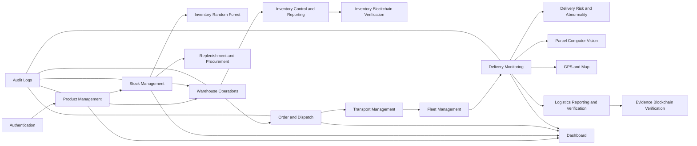

# IILAS Project Roadmap

**Project:** Integrated Inventory and Logistics Administration System (IILAS)  
**Systems:** Inventory Management and Logistics Management  
**Roadmap baseline:** 7 October 2026  
**Current release:** Supervisor-testable CRUD prototype  
**Live prototype:** https://fyp-inventory-and-logistics.web.app/

## 1. Project vision

IILAS combines inventory control and logistics dispatch in one web application. The system should allow authorised users to maintain an accurate product catalogue, monitor stock, prepare shipments, assign deliveries, dispatch inventory, and review operational activity.

The first release focuses on a reliable, database-connected prototype. Later releases expand the prototype into a fuller warehouse and delivery-management system.

### Source register

- Wong Ric Hang Inventory Project 1 folder: https://drive.google.com/drive/folders/1y-0p3-0pGY9DyDtGwW_nkXdi_8sw4qCr
- Choong Wai Kin Logistics Project 1 folder: https://drive.google.com/drive/folders/1fQManx342CdtkpqOMEZCU4EPLaDeNXay
- Consolidated requirement mapping: `FULL_SCOPE_TRACEABILITY.md`

The roadmap uses the latest aligned/final documents available in those folders. Older duplicate and editing copies are reference material only.

## 2. Technology stack

| Area | Technology | Purpose |
|---|---|---|
| Frontend | React 19 and TypeScript | User interface and application logic |
| Build tool | Vite | Local development and production builds |
| Authentication | Firebase Authentication | Email/password registration and sign-in |
| Database | Cloud Firestore | Products, shipments, unique keys, and audit records |
| Security | Firestore Security Rules | Account isolation and database-level validation |
| Hosting | Firebase Hosting | Online supervisor-accessible deployment |
| Validation | TypeScript validation utilities and Firestore rules | Form and database validation |
| AI services | Python, Pandas, Scikit-learn, FastAPI/Flask | Structured stock and delivery-risk analysis |
| Computer vision | OpenCV and TensorFlow/Keras | Parcel image preparation and MobileNetV2 classification |
| Mapping | HTML5 Geolocation, Leaflet.js, OpenStreetMap | User-approved latest delivery-location display |
| Blockchain | SHA-256, Solidity, Hardhat, Ethers.js, MetaMask | Hash registration and integrity verification |
| Testing | Firebase Emulator Suite and QA scripts | CRUD, security, transactions, and regression checks |
| Version control | Git | Source history and release checkpoints |

## 3. Architecture direction

Use a feature-based frontend architecture. Each module should contain its interface, validation, types, and data-access logic. Shared Firebase, UI, and utility code should remain outside individual features.

```text
src/
├── app/                       # Application shell, routing and global providers
├── features/
│   ├── auth/                  # Registration, login and password reset
│   ├── dashboard/             # Operational summaries and quick links
│   ├── products/              # Product catalogue CRUD
│   ├── stock/                 # Stock movements and adjustments
│   ├── warehouse/             # Receiving, picking and packing
│   ├── shipments/             # Shipment preparation and dispatch
│   └── delivery/              # Delivery progress and completion
├── components/                # Shared UI components
├── services/                  # Firebase and future backend integrations
├── hooks/                     # Shared React hooks
├── types/                     # Shared TypeScript models
├── utils/                     # Formatting and reusable helpers
└── styles/                    # Global styles and design tokens
```

The current application can be migrated toward this structure gradually. Refactoring must preserve working behaviour and should be followed by a production build and regression tests.

## 4. Current implementation status

### Completed

- [x] Online React and TypeScript application
- [x] Firebase email/password authentication
- [x] Account-isolated Firestore records
- [x] Dashboard with live product and shipment summaries
- [x] Product create, read, update, search, filter, and archive operations
- [x] Product images resized in the browser and stored with product records
- [x] Standard and custom product categories
- [x] Unique SKU and barcode enforcement
- [x] Shipment create, read, update, search, draft deletion, and dispatch workflow
- [x] Inventory-product search and selection inside shipment creation
- [x] Shipment lifecycle: Draft → Prepared → Dispatched
- [x] Driver assignment and picking/packing confirmation
- [x] Atomic stock deduction during dispatch
- [x] Insufficient-stock rejection
- [x] Locked dispatched records and preserved item snapshots
- [x] Audit activity records
- [x] Firestore security rules for ownership and business constraints
- [x] Firebase Hosting deployment
- [x] Responsive usability improvements for the supervisor prototype
- [x] Ten demonstration products and ten linked demonstration shipments
- [x] Local emulator smoke and security tests

### Partially completed

- [~] Responsive design: principal flows work, but broader device testing is required
- [~] Accessibility: labelled controls and focused errors exist; complete keyboard focus trapping and formal WCAG review remain
- [~] Automated testing: database and transaction flows are covered; component and browser end-to-end coverage remain limited
- [~] Project structure: Stock Management now uses a feature folder; the remaining large page components still need incremental extraction
- [~] Documentation: README, requirements, and QA reports exist; diagrams and final user documentation remain

### Planned

- [~] Stock Management: operational movements and reservations are complete; Random Forest risk classification remains
- [ ] Warehouse Operations and Prepared-Shipment Handover
- [ ] Replenishment & Procurement
- [ ] Inventory Control & Reporting with blockchain verification
- [ ] Transport Management
- [ ] Fleet Management
- [ ] Delivery Monitoring with risk, abnormality, parcel vision, evidence, and GPS/map functions
- [ ] Logistics Reporting & Verification with blockchain evidence checks
- [ ] Role-based access control
- [ ] Trusted backend workflow for larger shipments
- [ ] Pagination and production-scale image storage
- [ ] Complete automated UI test suite
- [ ] Final FYP report, presentation, and demonstration package

## 5. Delivery priorities

| Priority | Meaning | Examples |
|---|---|---|
| P0 | Required for a stable assessed prototype | CRUD, authentication, database connection, security, deployability |
| P1 | Required by the final Project 1 reports | Five inventory modules, five logistics modules, roles, AI, computer vision, GPS/map support, blockchain verification |
| P2 | Quality and scale improvements | Pagination, object storage, analytics, accessibility, performance |
| P3 | Optional extensions beyond the committed reports | Route optimisation, native mobile app, continuous background tracking, physical IoT devices, public blockchain |

P0 is substantially complete. AI and blockchain are P1 final-scope commitments in both reports. They must not be deferred as optional extensions. Browser geolocation is also required for the logistics scope, while a physical IoT implementation remains optional unless the reports are formally revised.

## 6. Development phases

### Phase 0 — Requirements and scope baseline

**Status:** Completed for the prototype

**Objectives**

- Map the inventory and logistics reports to implementable requirements.
- Define the supervisor-testable minimum scope.
- Separate working features from future concepts.
- Establish acceptance checks for CRUD and database persistence.

**Deliverables**

- [x] `REQUIREMENTS.md`
- [x] Product Management requirements mapping
- [x] Order & Dispatch requirements mapping
- [x] Prototype scope and exclusions
- [ ] Final reviewed requirements traceability matrix for the complete FYP

### Phase 1 — Foundation and deployment

**Status:** Completed

**Objectives**

- Establish the React and TypeScript application.
- Connect Firebase Authentication and Cloud Firestore.
- Configure account-owned database records.
- Publish the application through Firebase Hosting.

**Exit criteria**

- [x] A new user can register and sign in.
- [x] A signed-in user can access only their own records.
- [x] The application builds successfully.
- [x] The online URL loads the deployed production build.

### Phase 2 — Product Management CRUD

**Status:** Completed for the prototype

**Objectives**

- Create and maintain the warehouse product catalogue.
- Support product images and flexible categories.
- Protect identifiers and preserve shipment history.

**Implemented scope**

- [x] Create products
- [x] List and view products
- [x] Search by name, SKU, barcode, or category
- [x] Filter by category and stock condition
- [x] Update product details and stock-on-hand values
- [x] Archive products instead of breaking shipment references
- [x] Validate required fields, quantities, SKU, and barcode
- [x] Enforce account-level SKU and barcode uniqueness

**Future refinements**

- [ ] Bulk CSV import and export
- [ ] Product pagination
- [ ] Firebase Storage or equivalent object storage for production images
- [ ] Supplier and purchasing references
- [ ] Category administration screen

### Phase 3 — Order and Dispatch

**Status:** Completed for the prototype

**Objectives**

- Link logistics shipments to live inventory products.
- Enforce a controlled shipment lifecycle.
- Deduct inventory safely when dispatch is confirmed.

**Implemented scope**

- [x] Search and select warehouse products
- [x] Add quantities to a shipment
- [x] Create and edit Draft shipments
- [x] Delete Draft shipments
- [x] Confirm picking, packing, handover reference, and driver
- [x] Move shipments to Prepared
- [x] Dispatch with an atomic Firestore transaction
- [x] Reject quantities above available stock
- [x] Preserve historical product name and SKU snapshots
- [x] Lock Dispatched records

**Known prototype constraint**

New shipments are limited to two distinct products because the current Firestore security-rule transaction reaches document-access limits with larger item counts. Draft and Prepared shipments do not reserve stock.

**Future refinements**

- [ ] Move dispatch commands to a trusted server or Cloud Function
- [ ] Support an unrestricted number of shipment lines
- [ ] Add stock reservation for Prepared shipments
- [ ] Generate printable picking lists and delivery notes
- [ ] Add cancellation and controlled return workflows

### Phase 4 — Dashboard and operational visibility

**Status:** Completed for the prototype

**Implemented scope**

- [x] Total and active product counts
- [x] Reorder-level warning count
- [x] Draft, Prepared, and Dispatched shipment totals
- [x] Product category summary
- [x] Recent audit activity
- [x] Quick links to working modules
- [x] Dashboard cards linked to relevant filtered views

**Future refinements**

- [ ] Configurable date ranges
- [ ] Stock value and turnover indicators
- [ ] Shipment lead-time and delivery-performance charts
- [ ] Exportable management reports
- [ ] Role-specific dashboards

### Phase 5 — Stock Management

**Status:** Operational workflow completed; Random Forest extension remains — P1

**Objective**

Replace manual stock editing with traceable stock movements.

**Implemented features**

- [x] Stock receipt
- [x] Stock issue for damage, loss, or internal use
- [x] Positive and negative stock adjustment
- [x] Reservation and release
- [x] Full-balance location transfer for the current single-location product model
- [x] Movement reason and reference
- [x] User and timestamp audit trail
- [x] Product movement history and type filter
- [x] Available, reserved, and reorder indicators
- [ ] Random Forest stock-risk classification and reorder recommendation

**Suggested data model**

```text
stockMovements/{movementId}
  ownerId
  productId
  type: Receipt | Issue | Adjustment | Reservation | Release | Transfer
  quantity
  quantityChange
  reservedChange
  quantityBefore
  quantityAfter
  reservedBefore
  reservedAfter
  locationFrom
  locationTo
  reference
  reason
  actor
  createdAt
  productVersion
```

**Acceptance criteria**

- Every quantity change has a movement record.
- Product stock and movement history update atomically.
- Invalid negative stock is rejected.
- Users can search balances and filter history by movement type.
- Dispatch uses available stock and never consumes reserved units.
- Firestore rules reject fabricated movements and inconsistent product balances.

### Phase 6 — Warehouse Operations

**Status:** Planned — P1

**Objective**

Track the physical warehouse steps between inventory availability and shipment preparation.

**Planned features**

- [ ] Goods receiving
- [ ] Storage-location assignment
- [ ] Pick-list generation
- [ ] Picking confirmation by item
- [ ] Packing confirmation and parcel count
- [ ] Handover to logistics
- [ ] Exception recording for missing or damaged items

**Acceptance criteria**

- A warehouse task has a clear status and responsible user.
- Picked quantities cannot exceed available or reserved quantities.
- A shipment cannot become Prepared until mandatory warehouse checks pass.
- All operational changes produce audit records.

### Phase 7 — Delivery Monitoring

**Status:** Planned — P1

**Objective**

Track a dispatched shipment until delivery completion or exception resolution.

**Planned features**

- [ ] Controlled delivery status timeline
- [ ] Driver/rider assignment history
- [ ] Out-for-delivery status
- [ ] Delivered status with date and time
- [ ] Failed-delivery reason
- [ ] Parcel and proof-of-delivery image upload to Firebase Storage
- [ ] Random Forest delivery-risk prediction
- [ ] Explainable rule-based abnormal-delivery scoring
- [ ] MobileNetV2 parcel-condition classification with OpenCV preprocessing
- [ ] User-approved HTML5 geolocation updates
- [ ] Latest-location display with Leaflet.js and OpenStreetMap
- [ ] Delivery search and status filters
- [ ] Human review for high-risk, abnormal, damaged, or low-confidence results

**Acceptance criteria**

- Only valid status transitions are accepted.
- Delivery events retain their actor and timestamp.
- A completed delivery remains read-only except through an authorised correction flow.
- Dashboard totals reflect current delivery state.

### Phase 7A — Transport and Fleet Management

**Status:** Planned — P1

- [ ] Route and load planning records
- [ ] Carrier selection, ETA, cost, and transport schedules
- [ ] Vehicle CRUD and availability
- [ ] Driver/rider CRUD and assignments
- [ ] Maintenance and fuel records
- [ ] Fleet-status monitoring

Advanced route optimisation is optional; the required minimum is a controlled, traceable transport and fleet workflow.

### Phase 7B — AI and Computer Vision Services

**Status:** Planned — P1 research core

- [ ] Inventory Random Forest model for Normal, Reorder Risk, and Critical Stock Risk
- [ ] Logistics Random Forest model for Low, Medium, and High delivery risk
- [ ] Decision Tree baselines for both structured-data models
- [ ] Logistic Regression baseline for logistics delivery risk
- [ ] Rule-based abnormal-delivery scoring
- [ ] MobileNetV2 parcel-condition model and EfficientNet-B0 comparison
- [ ] Dataset provenance, cleaning, labelling, and version records
- [ ] Training, validation, and test separation
- [ ] Accuracy, precision, recall, F1-score, confusion matrices, and stability evidence
- [ ] Trusted API integration through FastAPI/Flask or controlled backend calls
- [ ] Stored model version, confidence, factors, and prediction timestamp

### Phase 7C — Blockchain Verification

**Status:** Planned — P1 research core

- [ ] Define canonical field/file hashing rules
- [ ] Create separate inventory-transaction and logistics-evidence verification workflows
- [ ] Implement Solidity smart contract registration and retrieval functions
- [ ] Compile, test, and deploy contracts on Hardhat local EVM
- [ ] Integrate Ethers.js and an authorised MetaMask test account
- [ ] Store transaction references with related Firestore records
- [ ] Demonstrate Verified, Unmatched, and Not Registered/Pending results
- [ ] Document that verification detects changes but does not prove original truth

### Phase 8 — Users, roles, and administration

**Status:** Planned — P1

**Suggested roles**

| Role | Main permissions |
|---|---|
| Administrator | User access, configuration, all records, reporting |
| Inventory staff | Products, receipts, adjustments, stock history |
| Warehouse staff | Receiving, picking, packing, handover |
| Logistics staff | Shipments, driver assignment, dispatch |
| Driver/Rider | Assigned deliveries and delivery updates |
| Supervisor | Read access, dashboards, reports, and audit review |

**Tasks**

- [ ] Define a permission matrix.
- [ ] Store role claims through a trusted backend.
- [ ] Enforce permissions in both the UI and database/backend.
- [ ] Add account activation and deactivation.
- [ ] Add an administrative audit view.

### Phase 9 — Quality, security, and production readiness

**Status:** In progress

**Security**

- [x] Account ownership enforced in Firestore rules
- [x] Required-field and record-shape validation
- [x] Atomic dispatch and stock checks
- [x] Direct invalid-write emulator probes
- [ ] Role-based authorisation
- [ ] Trusted backend for privileged commands
- [ ] Dependency and security review before final release
- [ ] Backup and recovery procedure

**Testing**

- [x] Product CRUD emulator test
- [x] SKU and barcode uniqueness test
- [x] Account-isolation test
- [x] Shipment and stock-deduction test
- [x] Insufficient-stock test
- [x] Concurrent-dispatch protection test
- [x] Live supervisor-flow retest
- [ ] React component tests for forms and status controls
- [ ] Automated browser tests for the principal user journeys
- [ ] Accessibility audit
- [ ] Cross-browser testing
- [ ] Mobile, tablet, and desktop breakpoint testing
- [ ] Performance and larger-dataset testing

**Performance and scale**

- [ ] Split the large JavaScript bundle by route or feature.
- [ ] Paginate products, shipments, and audit activity.
- [ ] Add Firestore indexes for final query patterns.
- [ ] Move large images out of Firestore documents.
- [ ] Define retention rules for audit and operational data.

### Phase 10 — Documentation and final FYP delivery

**Status:** In progress

**Technical documentation**

- [x] README with setup and deployment commands
- [x] Requirements and scope document
- [x] QA report and improvement retest
- [x] Project roadmap
- [ ] System architecture diagram
- [ ] Use-case diagram
- [ ] Entity-relationship/data-model diagram
- [ ] Activity or sequence diagrams for product and dispatch flows
- [ ] Test-case matrix with expected and actual results
- [ ] Deployment and recovery guide

**User documentation**

- [ ] Account registration and sign-in guide
- [ ] Product Management guide
- [ ] Shipment preparation and dispatch guide
- [ ] Stock Management guide when implemented
- [ ] Troubleshooting section

**Academic deliverables**

- [ ] Update Chapters 1–3 to match the final implemented scope.
- [ ] Document implementation decisions in Chapter 4.
- [ ] Present test evidence and evaluation results.
- [ ] State limitations accurately.
- [ ] Prepare conclusion and future-work recommendations.
- [ ] Prepare presentation slides and demonstration script.
- [ ] Record screenshots or a backup demonstration video.

## 7. Suggested 12-week execution plan

Adjust the week numbers to the official university submission schedule.

| Week | Focus | Required outcome |
|---|---|---|
| 1 | Baseline and project organisation | Clean feature plan, Git baseline, confirmed requirements |
| 2 | Refactor safely | Feature-based folders, unchanged behaviour, passing build |
| 3 | Stock Management | Stock movement CRUD, reservations, indicators, and history |
| 4 | Warehouse and procurement | Picking/packing handover, reorder, supplier, and PO workflow |
| 5 | Transport and fleet | Minimum viable transport schedule, vehicle, and driver workflows |
| 6 | Delivery evidence and GPS | Status events, Storage uploads, geolocation, and map display |
| 7 | Structured AI | Inventory and logistics Random Forest datasets, baselines, and evaluation |
| 8 | Computer vision | Parcel dataset, MobileNetV2, EfficientNet-B0 comparison, and inference |
| 9 | Blockchain verification | SHA-256 formats, Solidity contracts, Hardhat tests, and web integration |
| 10 | Roles, security, and integration | Permission matrix, backend controls, and complete handover path |
| 11 | End-to-end evaluation | Functional, AI, blockchain, usability, accessibility, and UAT evidence |
| 12 | Documentation and final release | Report alignment, tagged deployment, slides, and rehearsed demonstration |

If time is shorter, reduce each business module to a clearly defined minimum workflow, but retain demonstrable AI and blockchain implementations because they directly support both students' stated research objectives.

## 8. Data and module dependencies



Build features in dependency order. Product and stock accuracy must be reliable before warehouse, shipment, and delivery automation depend on them.

## 9. Testing strategy

| Test level | Purpose | Main targets |
|---|---|---|
| Validation tests | Reject invalid form and service input | Products, stock movements, shipments, delivery events |
| Firestore emulator tests | Verify rules and atomic writes | Ownership, uniqueness, stock deduction, status transitions |
| Component tests | Verify interface behaviour | Forms, dialogs, filters, status buttons |
| End-to-end tests | Verify complete user journeys | Login, product CRUD, prepare, dispatch, deliver |
| Manual exploratory tests | Find usability and responsive issues | Desktop, tablet, mobile, keyboard navigation |
| User acceptance testing | Confirm FYP requirements with supervisor/users | Required functional requirements and demonstration tasks |

Every completed feature should include:

1. Normal successful operation.
2. Required-field validation.
3. Boundary and insufficient-stock cases.
4. Unauthorised access rejection.
5. Persistence after reload.
6. Audit evidence.
7. Responsive interface review.

## 10. Release and deployment workflow

### Local validation

```powershell
npm install
npm run lint
npm run build
```

Run the relevant Firebase emulator and QA scripts before deploying rule or transaction changes.

### Firebase deployment

```powershell
npx firebase deploy --only hosting,firestore:rules --project fyp-inventory-and-logistics
```

### Release checklist

- [ ] All required checks pass.
- [ ] Firestore rules match the application data model.
- [ ] No credentials, private keys, or personal data are committed.
- [ ] Demonstration data is clearly labelled and non-sensitive.
- [ ] The production build loads at the live URL.
- [ ] Sign-in, Product CRUD, shipment preparation, and dispatch are smoke-tested.
- [ ] Dashboard values update after the test workflow.
- [ ] The release is tagged in Git with a clear version.
- [ ] README and roadmap status are updated.

## 11. Supervisor demonstration milestone

The current prototype is ready to demonstrate the following path:

1. Register or sign in.
2. Review live Dashboard totals.
3. Create a product with an image and custom category.
4. Search and view the product.
5. Update the product.
6. Create a Draft shipment using the warehouse product search.
7. Assign a driver and confirm preparation.
8. Dispatch the shipment.
9. Confirm that inventory was deducted.
10. Show the updated Dashboard and audit activity.
11. Archive the temporary product or delete a temporary Draft record.
12. Open Firebase Console to demonstrate database persistence if requested.

The demonstration can present Stock Management as implemented and emulator-tested. Warehouse Operations and Delivery Monitoring remain planned modules.

## 12. Risks and controls

| Risk | Impact | Control |
|---|---|---|
| Scope grows beyond the available FYP time | Core modules remain unfinished | Prioritise P0/P1 and defer advanced features |
| Direct client writes bypass business logic | Invalid or inconsistent data | Firestore rules now; trusted backend for privileged workflows |
| Concurrent dispatch causes incorrect stock | Negative or duplicated stock use | Atomic transactions and emulator concurrency tests |
| Large shipments exceed Firestore rule limits | Cannot scale beyond two products | Move dispatch to a trusted backend function |
| Embedded images enlarge Firestore records | Cost and performance problems | Resize now; migrate to object storage later |
| Manual stock editing weakens traceability | Inaccurate inventory history | Quantity and location changes now use immutable Stock Management movements |
| Local files are moved or lost | Development interruption | Git commits, remote backup, documented setup |
| Demo depends on network availability | Failed presentation | Prepare screenshots/video and a tested local build |
| Placeholder modules are mistaken for completed work | Incorrect evaluation expectations | Keep Coming soon labels and explain scope clearly |

## 13. Definition of done

A feature is complete when:

- Its user story and acceptance criteria are documented.
- The interface supports loading, empty, validation, success, and error states.
- Data persists correctly after reload.
- Authentication and authorisation are enforced.
- Database operations preserve related records and invariants.
- Audit information is recorded where required.
- Relevant automated tests pass.
- Desktop and narrow-screen layouts are checked.
- User and technical documentation are updated.
- The production build succeeds without TypeScript or lint errors.
- The deployed feature is smoke-tested on Firebase Hosting.

## 14. Immediate next actions

1. Commit the current working prototype as a baseline release.
2. Finalise shared roles, IDs, evidence metadata, and the Prepared-Shipment Handover contract.
3. Implement Warehouse Operations and the Prepared-Shipment Handover workflow.
4. Design the inventory-risk, delivery-risk, and parcel-image datasets before writing model code.
5. Implement delivery evidence upload and GPS/map records needed by the logistics AI and blockchain flows.
6. Build and evaluate the required Random Forest and MobileNetV2 models against their baselines.
7. Implement and test the two Solidity/Hardhat hash-verification workflows.
8. Add component and browser tests for the complete integrated path.
9. Continue extracting the remaining page components into feature folders.
10. Create architecture, use-case, data-model, AI-pipeline, blockchain, and workflow diagrams.
12. Update both written FYP reports so every claimed function and technology matches tested evidence.

## 15. Change log

| Date | Change |
|---|---|
| 7 October 2026 | Created the full-project roadmap from the implemented prototype, requirements, and QA evidence. |
| 7 October 2026 | Reviewed both supplied Google Drive folders and promoted the documented AI, computer-vision, GPS/map, and blockchain functions into the P1 final scope. |
